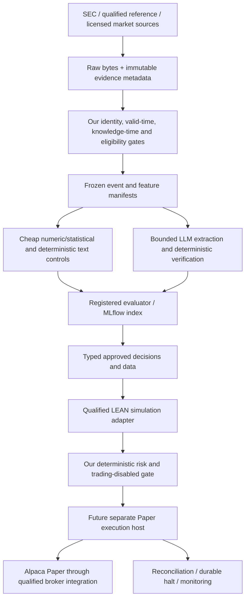

# Build versus adopt audit — 2026-10-17

**Decision:** retain the scientific evidence, identity, eligibility and safety contracts; adopt commodity libraries and integrate an established equity engine underneath those contracts. Do not migrate the repository wholesale to an LLM trading framework. Prefer **LEAN for a future, contract-tested simulation/execution integration**, with NautilusTrader as a challenger. Keep the current Alpaca read-only foundation while that integration is evaluated. No framework is admitted for registered performance evaluation by this document.

Repository: `emanuel894/trading_agent`, branch `feat/alpaca-paper-foundation`, inspected baseline **`9ff6aa4c5fcedd1051ee3265a7d7982fa4215f9b`**. This is an architecture decision and implementation proposal, not a research amendment, acquisition authorization, performance result, deployment or trading approval.

## 1. Scientific objective and present boundary

Test whether AI/LLM-derived information adds **incremental net alpha after costs relative to strong, cheap quantitative/statistical controls**. The LLM can lose and be removed. Framework convenience, simulated profit and more elaborate agents do not change that objective.

The active contract is [ADR 001](trading_agent_starter/ARCHITECTURE_DECISION_001.md) together with its applicable registered amendments, particularly [003](trading_agent_starter/LIQUIDITY_AMENDMENT_003.md), [004](trading_agent_starter/ACQUISITION_SAMPLING_AMENDMENT_004.md) and [005](trading_agent_starter/STRUCTURAL_IDENTITY_AMENDMENT_005.md). Older roadmap text is historical context; this audit does not restore the superseded baseline → LLM → six-agent sequence. It does not change registered periods, event selection, arm definitions, deadlines, costs, splits or promotion standards. The originally proposed capture start has passed; no revised dates or successful prospective capture are inferred here.

**Candidate #1 FMBH remains UNRESOLVED.** The [October 7 review](trading_agent_starter/FMBH_MASSIVE_SOURCE_REVIEW_20261007.md) and its [machine-readable record](trading_agent_starter/research/fmbh_massive_source_review_20261007.json) establish four date-level reference assertions, not a complete issuer-class set, uninterrupted lineage or validity at exact instants. Remaining targets include May 1, 2025 00:00 EDT and May 9 09:52:26/10:03 EDT. The remaining 58 session dates and authenticated Alpaca SIP daily acquisition are additional gaps. Neither LEAN map files, a Databento instrument ID, SEC CIK, FIGI nor an SDK closes those gaps by itself.

No Massive data API request was made. Do not spend the 58 calls until a defensible structural interval/class-completeness path exists. Do not substitute another issuer, advance candidate #2, freeze a cohort, append a favorable ledger decision or introduce Amendment 006 as an architectural shortcut.

## 2. Method and evidence limits

Inspected repository modules, all existing test modules, CI, requirements, registrations and substantive source reviews. Retrieved current public upstream HEAD/tag references and commit-pinned README, implementation, dependency and license files for **24 repositories**. Inspected full archive file listings for TradingAgents and NautilusTrader; selected implementation files were read, not every line of every project. Also inspected public PyPI release metadata. Stars, downloads and benchmark marketing were not selection criteria.

The reproducible [source inventory](audit/20261017/upstream_sources.json) records exact commits, URLs, retrieval timestamps, byte hashes, successful files, failed path guesses, observed version tags and package-release metadata. Source IDs below map to the [source index](#source-index). [Reproduction instructions](audit/20261017/README.md) separate source retrieval from executable installation.

**Important limits:** GitHub's metadata API and direct vendor/documentation websites returned proxy `403` errors. Commit-pinned documentation inside repositories was accessible. Git tags establish observed references, not GitHub release publication dates or artifact attestations. PyPI upload times establish package publication, not supported production operation. Several HEADs differ materially from published packages. No third-party trading framework or model was installed, executed, timed or benchmarked. Commercial contracts, current SaaS prices, entitlements and account-specific compatibility remain unverified. Blocked URLs and missing-file guesses are recorded, not presented as inspected evidence. No negative feature claim rests solely on a guessed path returning 404.

## 3. What exists here, and what replacing it would lose

Approximately 5,900 lines of application Python and 2,700 lines of tests form a bounded read-only research/acquisition foundation, not a complete autonomous trading system. There is no repository-wide license file at this baseline; do not assume permission to relicense or redistribute our code or licensed datasets when combining projects.

| Existing component | Finding and decision | What must survive an integration |
| --- | --- | --- |
| `audit_store.py` | **KEEP_OURS.** Content-addressed bytes, SQLite transactions, immutable-row triggers, version/chain hashes and verification. Small enough to understand and test. | Original bytes, provenance, capture mode and append-only corrections. `as_of` filters local `recorded_at`; it is **not** a complete valid-time/knowledge-time query engine. Hashes/triggers are not external timestamp attestation, access control, WORM or a backup service. |
| `acquisition_identity.py`, registration 005 | **KEEP_OURS.** Field-specific, source-grounded structural semantics; date/instant distinction and independent interval corroboration; unknowns remain unresolved. | The narrow later-retrieval structural-valid-state exception must never become permission to backdate predictive knowledge or market actionability. Review flags and matched source spans are reviewed assertions, not a machine proof that a source is complete. |
| `cohort_selector.py`, `cohort_selector_v3.py`, scope/registration/replay modules | **KEEP_OURS.** Dated class mappings, complete populations, exact lookbacks, Decimal arithmetic, protected hashes, deterministic candidate order and no replacement. | Surviving/delisted/renamed instruments, issuer/class identity, reasons for exclusions and unresolved states. Keep older versions for registered replays; do not consolidate or delete them casually. |
| `audit_http.py`, `audit_sec.py`, `audit_text.py`, source/dated gates | **KEEP_OURS** admission and bounded transport; **INTEGRATE** parser helpers later. GET restrictions, explicit source clocks, SEC envelope crosschecks, document spans and comparison checks have real value. | Acceptance ≠ first disclosure; historical retrieval ≠ original receipt. Complete relevant filing/exhibit inventory, period/entity checks, failure records and raw-byte grounding. Current parser is bounded, not a universal SEC/XBRL implementation. |
| `audit_market.py`, `market_data.py`, `alpaca_daily_contract.py`, acquisition probes | **KEEP_OURS** contracts; **ADOPT** maintained SDK transport where appropriate. | IEX 30-minute RTH contract is distinct from SIP minute/quote evidence and provider-native SIP `1Day`, raw, `asof=-` liquidity inputs. Never recreate registered daily bars by RTH aggregation. Preserve native timestamp precision, corrections and historical symbols. |
| `broker.py`, `alpaca_paper.py`, `alpaca_history.py` | **KEEP_OURS** thin boundary over official `alpaca-py`. The protocol has no submit method; the trading client hard-codes `paper=True`; unsafe flags are rejected. | Credential separation, feed restrictions and trading-disabled behavior. Snapshot success is not continuous reconciliation, freshness proof, account safety certification or order capability. |
| `risk.py`, `ledger.py` | **KEEP_OURS** policy semantics and regression fixtures. Pure checks cover stale/invalid quotes, reservations, exposure and a durable halt. | These are prototypes: default limits differ from ADR research limits, and the current halt check rejects sells too, whereas ADR research halts block entries while scheduled exits continue. No integrated production allocator or crash-safe broker outbox exists. A reserved local intent is not broker exactly-once execution. Do not treat framework risk defaults or this prototype as the registered production policy. |
| `replay.py` | **KEEP_OURS** as a transparent regression oracle; **DROP** plans to grow it into a general multi-asset engine. | Next-bar timing, costs, future-input invariance and explicit synthetic labels. It is single-asset, long-only and lacks complete corporate-action, quote, halt, terminal-outcome and portfolio lifecycle treatment. Its scores do not establish the registered event experiment. |
| IBKR adapter and Windows scripts | **DEFER** further IBKR work; retain reference behavior. Current work is Alpaca Paper. | No need to delete working portability/safety examples. Linux tests do not establish execution of Windows scripts or a TWS handshake. |
| CI and dependency declarations | **KEEP_OURS** full suite; **INTEGRATE** standard automation/security checks. | CI already declares Python 3.13 on Ubuntu/Windows, read-only permissions, all tests and demo. Tags for Actions and open transitive ranges are reproducibility risks; later pin approved actions and resolve dependency constraints in a separate reviewed change. |

## 4. Decisions by subsystem

`KEEP_OURS` retains project-specific authority; `ADOPT` uses an existing implementation rather than rebuilding it; `INTEGRATE` adds a bounded adapter beneath our contract; `BENCHMARK_ONLY` admits an experimental comparator with no operational authority; `DEFER` postpones adoption; `DROP` stops a proposed direction, not deletion of registered evidence. Future integrations below are proposals, not dependencies added by this audit.

| Subsystem | Primary classification | Practical choice, timing and non-negotiable boundary |
| --- | --- | --- |
| Evidence/provenance store | **KEEP_OURS** | SQLite + content-addressed objects remain canonical. Add standard object-store backup/access controls when required. Neither MLflow nor an agent chat history replaces raw-source evidence. |
| PIT security master / eligibility reconstruction | **KEEP_OURS** | Keep admission schema, historical instrument IDs and eligibility logic. **INTEGRATE** a qualified historical reference vendor only after field/resolution/completeness evidence. No inspected framework proves the FMBH requirement. |
| SEC acquisition | **INTEGRATE** | Keep original SEC envelope acquisition/provenance. Evaluate EdgarTools for local parsing of captured bytes and extraction crosschecks; use CIK/accession inputs, never a current ticker map as historical truth. |
| Market-data acquisition | **ADOPT** | Official Alpaca SDK for supported operations; current bounded raw HTTP remains useful for byte-level provenance and contract-specific requests. Databento SDK is a conditional additional source, not a replacement feed selected silently. |
| Quantitative features/models | **ADOPT** | scikit-learn `Pipeline`, ridge and a gradient-boosting implementation that exactly matches the registered specification and frozen tuning budget. No custom optimizer/ML library. Qlib is **BENCHMARK_ONLY** initially. |
| LLM/text research | **INTEGRATE** | A bounded provider extractor with versioned prompt/schema, source spans, deterministic validation, abstention and cost accounting. TradingAgents and FinGPT are **BENCHMARK_ONLY**, separately registered, not the decision authority. |
| Agent orchestration | **DEFER** | A fixed sequence and existing command boundaries are sufficient now. LangGraph is a later **INTEGRATE** candidate if durable branching/resume is measured to be necessary. **DROP** an always-running debate/six-agent manager hierarchy. |
| Experiment management | **ADOPT** | Local/self-hosted MLflow for runs, metrics and artifact indexing when fitting starts; retain Git-registered protocol and evidence references as authority. Logs include failed trials, model calls and costs. |
| Backtesting/simulation | **INTEGRATE** | LEAN is the preferred target below a contract adapter, conditional on timing/fill/identity acceptance. Nautilus is **BENCHMARK_ONLY** initially. Do not build a new generic event engine. |
| Risk engine | **KEEP_OURS** | Own the deterministic policy, limits, halt semantics and acceptance tests. Eventually enforce them through a framework risk/order boundary as well as an external gate; LLM risk debate has no approval power. |
| Order/execution engine | **DEFER** | Reuse LEAN order lifecycle/Alpaca plugin after simulation acceptance and a separate Paper gate. **DROP** building a general OMS from scratch. Retain a small durable policy/intent boundary where framework guarantees are insufficient. |
| Broker integration | **ADOPT** | Maintain the thin official Alpaca SDK wrapper now; evaluate the existing LEAN Alpaca plugin later. Do not maintain a second custom HTTP trading client. No live credentials in development or review. |
| Monitoring/reconciliation | **INTEGRATE** | Adopt engine connection/order tracking and a process supervisor; retain explicit account/state invariant checks, source snapshots, startup reconciliation and operator halt/reset policy. A running process is insufficient. |
| GitHub/cloud agent automation | **INTEGRATE** | Codex implementation + independent Claude review + mandatory CI + human merge. Use existing vendor actions, not a custom multi-agent SaaS. Gemini is **DEFER** pending measured marginal value. |
| Data/version lineage | **ADOPT** | Git for code/protocol/manifests; DVC for eligible large artifacts, backed by private versioned object storage. Preserve immutable evidence hashes and access/rights records; DVC does not prove PIT validity. |
| Analytical storage | **INTEGRATE** | Parquet + DuckDB for derived, read-only projections once scale warrants it. EvidenceStore remains canonical; include source IDs/version hashes in every projection. No lakehouse cluster now. |
| Observability | **ADOPT** | Structured redacted logs and OpenTelemetry traces/metrics as services arrive. Correlate run, evidence, experiment, model request, intent and broker IDs. Do not put raw filings, keys or account data in telemetry by default. |
| Secrets/security | **ADOPT** | Provider/project-scoped secrets, GitHub environments and short-lived GitHub App tokens; supported secret manager/OIDC where applicable. Separate research acquisition and future trading hosts. An instruction file is not a security boundary. |
| Calendars/corporate actions | **INTEGRATE** | Use engine/reference calendars and `exchange_calendars` as a crosscheck; retain source-grounded session/corporate-action versions and treatment of delistings. Calendar libraries cannot prove an instrument was tradable. |

## 5. Current upstream comparison

Versions below are observations on this audit date, **not a blanket upgrade recommendation**. Exact inspected HEADs and files are in the source index/inventory. Published runtime requirements and HEAD requirements are intentionally distinguished.

| Project | Version/release evidence; license/runtime | Maturity, fit and decision |
| --- | --- | --- |
| TradingAgents [S01] | Observed `v0.7.0` tag and October changelog; HEAD requires Python ≥3.11; Apache-2.0. PyPI package lookup under `tradingagents` returned 404. | Maintained research framework with real recent PIT work, graph/checkpoint isolation and provider support. **BENCHMARK_ONLY** for text/agent alternatives. Medium adapter cost, high cost and invalidation risk if made the whole platform. |
| QuantConnect LEAN [S02, S24] | Commit/build-tag stream; core Apache-2.0. Inspected launcher targets .NET 10; Python bridge setup document specifies 3.11.11. Separate Alpaca plugin source inspected. | Broad equity lifecycle, calendars, simulation and broker infrastructure. **INTEGRATE**, preferred engine subject to acceptance. Medium–high integration cost; moderate lock-in to engine data/events, greater lock-in if using hosted data/cloud APIs. |
| NautilusTrader [S03] | PyPI stable **1.231.0**, Python ≥3.12,<3.15; inspected HEAD **2.0.0rc8**, Python ≥3.13,<3.15, Rust core; LGPL-3.0-only. | Strong deterministic event architecture, risk, reconciliation and high-resolution simulation. Material v1/v2 transition; no Alpaca path in the inspected HEAD archive listing or integration table. **BENCHMARK_ONLY** now; high Alpaca migration cost. |
| Microsoft Qlib [S04] | PyPI **0.9.7**; Git tag **v0.9.8** also observed. HEAD Python ≥3.8, MIT. Source README explicitly identifies unreleased security/config migration changes. | Useful model library, datasets/processors, recorder and backtest ecosystem. **BENCHMARK_ONLY** initially; selected model/feature integrations can follow. Medium data/label adapter cost; does not provide our source admission. |
| Microsoft RD-Agent [S05] | PyPI **1.0.0**, uploaded September 2026; Python ≥3.10, MIT. | Active research/code-generation environment, Qlib factor/model loops, runtime/workspace support. **BENCHMARK_ONLY**, train/validation sandbox with trial limits. High governance risk if allowed to optimize against a holdout. |
| FinGPT [S06] | Observed **v1.0.0** tag; repo MIT, heterogeneous requirements/notebooks, no uniform Python support contract established. README model examples emphasize 2023–24 releases. | Financial text models, instruction datasets and forecasting recipes; not a complete broker/OMS/PIT platform. **BENCHMARK_ONLY**; model/data/base-weight licenses and training contamination require separate review. GPU/fine-tuning cost unjustified initially. |
| Alpaca official SDK/MCP [S07, S08] | `alpaca-py` PyPI **0.44.0**, Python ≥3.10,<4, Apache-2.0; ours remains **0.42.2**. MCP **2.4.0**, Python ≥3.10, MIT, October 12 upload. | **ADOPT** SDK through our boundary; **DEFER** direct MCP account access, **DROP** LLM-to-order authority. MCP v2 is a schema-breaking OpenAPI/FastMCP rewrite with toolset filtering. |
| Codex Cloud / CLI / action [S09, S10] | CLI Apache-2.0, observed `rust-v0.163.0` tag; action Apache-2.0, `v1.13` tag. Rust CLI; inspected action sets up Node 24, independently of our Python runtime. Hosted Cloud/model access has separate commercial terms. | **INTEGRATE** as bounded implementer; action provides controlled CI invocation, permissions and API proxy, not a research runtime or independent proof of correctness. Cloud feature/price details beyond accessible official repo docs remain unverified. |
| Claude Code / action [S11, S12] | CLI repository license says all rights reserved/commercial terms, observed `v2.1.302`; action MIT, observed `v1.0.252`. Native CLI install recommended; npm installation marked deprecated. Inspected composite action installs Bun 1.3.14; no Python dependency coupling. | **INTEGRATE** for independent static PR review. Action has actor controls and security guidance; CLI itself is not made open-source by the wrapper's MIT license. Separate provider billing, model/version and audit trail required. |
| Gemini CLI / action [S13, S14] | CLI Apache-2.0, Node ≥20; stable-style tag `v0.64.0`; inspected HEAD package is a **0.66 nightly**. Action Apache-2.0, observed `v0.1.22`. | Credible alternative implementer/reviewer, API key or GCP WIF, GitHub App support. **DEFER** third standing integration; **BENCHMARK_ONLY** in an offline agent bake-off if it can replace one role at lower cost or find distinct defects. |

### TradingAgents: credit the improvements, preserve a stricter contract

The current README/changelog describes as-filed EDGAR fundamentals, historical date enforcement, social/news restrictions, memory resolution cutoffs, isolated backtests and scoring at the first close after a decision date. These are substantive improvements over earlier demos. The inspected graph implements run signatures/checkpoint isolation and a historical memory cutoff; the EDGAR implementation selects facts by their `filed` date rather than merely a reporting period. Do not dismiss this project using an obsolete claim that it has no PIT controls.

There are still concrete mismatches:

* `agents/context.py` obtains present-day Yahoo company profiles. Historical context suppresses current sector/industry/exchange, but explicitly still supplies the current company name as an identifier. This cannot establish historical class/issuer identity across ticker reuse or legal changes. Its lookup fails open; our eligibility boundary must fail closed on unknown identity.
* `vendors/sec_edgar.py` resolves via SEC's current ticker map and filters companyfacts by **filing date**. Useful date-granularity fundamentals do not establish our original MD&A accession bytes, acceptance/receipt/action instants, complete prior disclosure or exact vintage at an intraday cutoff.
* `backtest.py` scores ticker/date ratings and parses alpha rounded to 0.1 percentage point. Its first-subsequent-close rule is sensible for that contract; it is not our quote-based executable opportunity, spread/size/halts/cost model, common event denominator or incremental C-minus-best-control test.
* An LLM risk/portfolio manager can be an experimental advisor but cannot approve or override deterministic limits. Date filtering cannot remove future knowledge embedded in model weights.

Replacement would lose our grounded evidence, exact-time/class gate, registered trial/candidate rules and explicit unresolved states unless recreated. Benchmark it only by injecting an approved frozen evidence bundle, disabling live vendor/memory escape paths and scoring under our evaluator. If that adaptation costs more than the scientific value of the comparison, defer the benchmark; do not fork the entire framework merely to use its prompts.

### LEAN: reuse equity machinery, qualify the execution semantics

Inspected `MapFile`/`MapFileRow` supports dated mapped symbols and primary exchange; the history provider synchronizes subscriptions and supports fill-forward; the brokerage transaction handler and Alpaca plugin provide substantial lifecycle machinery. This is more relevant to US-equity operations than adding more LLM debating agents.

The preferred boundary is a separately pinned engine process/container. Export only admitted data and typed decisions; return engine events/fills with evidence references. Use engine identifiers as a mapping target, never as the canonical research identity. Freeze engine commit, container digest, bridge/runtime, adapter version, calendar, map/factor data and all settings. A container boundary avoids forcing our Python 3.13 application into an incompatible Python.NET environment. Core source is self-hostable; hosted subscriptions, data rights and export availability are separate decisions.

Default behavior must not silently enter research results. `Security.cs` falls back to adjusted normalization when no subscription mode is present; the history provider can fill forward. The Alpaca plugin README describes zero slippage and immediate complete simulated market fills, and contains stale T+2 settlement/Python guidance. Its current implementation includes order-stream disconnection gating and duplicate-execution tracking, but those mechanisms are not a verified guarantee for our deployment. Use implementation tests and current account/source contracts, not old example defaults.

For this experiment: set raw/unadjusted source treatment explicitly, retain separate corporate-action cash/share transformations, prohibit synthetic missing-interval fills, preserve quote native precision through import, gate dissemination by availability rather than event timestamp alone, supply our registered fees/slippage/size/status rules, and retain unexecutable/terminal outcomes. LEAN's standard brokerage model or risk-management algorithm is not our registered risk gate. CIK/class completeness and knowledge-time provenance remain external obligations. If these conditions cannot be demonstrated without extensive core patches, do not adopt LEAN for the scientific evaluator; compare the challenger before writing a substitute engine.

### NautilusTrader: a strong engine with a material present-day fit gap

Inspected Rust risk code has trading-state, order-notional and submission/modification throttling mechanisms; backtest engine and live documentation support a reusable deterministic event architecture. Instrument/event models and high-resolution feeds are attractive for quote simulation. The current integration table includes Databento and Interactive Brokers; the complete inspected HEAD archive listing has no Alpaca-named path. This is evidence about this checkout, not a claim that no third-party Alpaca adapter exists anywhere.

Current source is **v2 release-candidate code**, while PyPI's stable line is v1 with a different Python API. Do not mix stable wheels with v2 documentation or assume the v1/v2 adapters are interchangeable. Versioned corporate actions, SEC-to-class lineage, full US-equity outcome coverage and our as-known policy still need qualification. LGPL obligations for redistributed modified libraries must be reviewed; the license does not automatically require all independent application code to use LGPL.

A future bake-off should start with a pinned stable package in an isolated environment and synthetic fixtures; use v2 only in an explicitly separate trial. For current Alpaca scope, writing and maintaining a new adapter plus navigating the transition is a poor first investment. If broker scope later returns to IBKR, or an officially supported Alpaca integration and stable v2 arrive, reconsider using the same acceptance bundle.

### Qlib and RD-Agent: useful research accelerators, no exemption from experiment rules

Qlib's `DataHandlerLP` separates inference/learning processing, and processors explicitly require training-only fit dates. Example configurations demonstrate split declarations. Its expression engine also permits forward references appropriate for labels: a framework does not prevent someone from accidentally moving them into features. Demo Yahoo/community datasets, adjusted data, convenient missing-value processing and prebuilt universes are not admissible replacements for our historical population and provenance.

Use an admitted event/instrument-indexed feature table, training-only fit, grouped/purged time splits for overlapping issuer episodes, and our registered metrics. Qlib's conventional daily ranking benchmarks/labels must not redefine the original 10-Q experiment. Keep any Qlib/RD-Agent environment separate from the minimal acquisition service. Source README warns that artifact/config loading security changes are unreleased: do not assume the PyPI version has HEAD's protections, and never load untrusted pickle/config artifacts.

RD-Agent can generate factor/model code, execute experiments and consume evaluation feedback. Its published performance/cost claims are upstream research claims, not our results. Give it training and validation views only, a finite registered proposal budget, no final-test credentials/artifacts, no broker keys and no power to amend the protocol. Count every proposed/evaluated trial, including failures. It can later be a stronger cheap-control discovery comparator, not a mechanism to repeatedly mine a holdout or to ensure an LLM arm wins.

### FinGPT: evaluate a model, do not import its demonstration data assumptions

The inspected forecaster `data.py` downloads Yahoo adjusted closes, obtains present-day basic financial series, groups news/returns weekly and builds labels. This is a useful example pipeline, not evidence of exact historical availability or an issuer/class master. MIT repository licensing does not license all Llama-family weights, adapters, scraped texts, vendor data or redistributed model outputs. Freeze model/tokenizer/adapters, inference stack, dataset rights and known training-date limitations before a benchmark. Start with a small extraction/sentiment challenger using the same admitted passages and evaluator; do not fund fine-tuning before cheap controls and source feasibility are established.

### Alpaca Agentic/MCP: official connectivity is not a safe trading policy

The official SDK is already the correct reuse decision. Keep the tested 0.42.2 dependency until a separate compatibility upgrade is justified; latest 0.44.0 was inspected as a candidate, not installed into the repository environment.

The official MCP v2 code defaults to Paper but supports the live endpoint via `ALPACA_PAPER_TRADE`; unset toolset selection means **all tools**. It registers order overrides. Our `TRADING_ENABLED=false` and `ALLOW_PAPER_ORDERS=false` flags do not automatically constrain that separate server. Therefore do not attach a broker-key-bearing MCP server to coding, review or experimental text agents. If a later human-facing read-only integration is justified, run it behind a separately enforced method/route/tool allowlist, explicitly enumerated data-only toolsets, no trading endpoints and no live credentials. Verify the actual exposed tool list and rejection paths; tool descriptions and a Paper default are insufficient.

The public Agentic product page could not be read in this environment. No unsupported claim is made about its current hosted safeguards, pricing, custody or suitability. The inspected official MCP implementation proves useful connectivity, not compliance with our scientific contract. No account was connected or configured.

## 6. Other components worth reusing

| Component | Actual evidence and choice | PIT/correctness, extensibility, cost and lock-in |
| --- | --- | --- |
| EdgarTools [S15] | MIT. PyPI 5.62.0 says Python ≥3.10; HEAD requires ≥3.11. README and HTTP helper code inspected. **INTEGRATE** local SEC parsing only after a fixture comparison. | Mature filing abstractions and throttling/retry helpers reduce custom parsing work. Our transport records complete raw bytes and stricter budgets; retain it. Parsed sections must retain accession, source hash and spans. Library extraction does not prove class completeness. Low–medium integration cost; low lock-in if normalized outputs are owned here. |
| scikit-learn [S20] | BSD-3-Clause; PyPI 1.9.1 supports ≥3.11; development HEAD requires ≥3.12. **ADOPT** bounded pipelines and registered estimators. | Training-only transformers and explicit seeds; split/label leakage remains our responsibility. No brokerage dependency; low migration cost. A library choice cannot silently alter the registered squared-loss tree method or grids. |
| MLflow [S16] | Apache-2.0; PyPI 3.17.1, ≥3.10; HEAD is 3.17.2 development. **ADOPT** run/artifact tracking at model stage. | Self-host/local option, provider-neutral. Records can be mutable/deletable; not evidence WORM or a preregistration authority. Record parent manifest hashes; private access controls; no public tracking server. Low–medium cost; no hosted service required. |
| DVC [S17] | Apache-2.0; PyPI 3.67.1, ≥3.9. **ADOPT** large-artifact pointers and reproducible data stages when needed. | Hash/version lineage does not establish availability, complete universe or lawful redistribution. Keep licensed raw objects private; object versioning/backups protect against loss, not temporal leakage. Low–medium setup, storage/egress cost; low lock-in with retained manifests. |
| DuckDB/Parquet [S19] | DuckDB MIT; PyPI 1.5.6, ≥3.10. **INTEGRATE** analytical views, not a new canonical database. | Excellent local joins/scans; every join must use identity and admissible knowledge/valid-time bounds, not a latest-row shortcut. Columnar storage can lose timestamp precision if configured poorly. Low cost and low lock-in. |
| `exchange_calendars` [S18] | Apache-2.0; 4.13.2, Python ≥3.10,<4; XNYS implementation inspected. **INTEGRATE** session calculations/crosschecks. | Pin calendar version and audit exceptions. Exchange sessions do not establish single-security halt/delist status; do not silently replace registered source sessions. Low integration cost. |
| OpenTelemetry [S21] | Apache-2.0, observed v1.45.1; Python SDK/README inspected. **ADOPT** instrumentation at service stage. | Provider-neutral traces do not replace evidence or reconciliation. Redact payloads; distinguish monotonic duration and UTC event clocks. Low–medium cost; collector/backend costs depend on retention and volume. |
| LangGraph [S22] | MIT; inspected library 1.2.16, Python ≥3.10. **DEFER** until branching/resume needs justify integration. | Useful graph/checkpoint plumbing; side effects must still be idempotent and broker writes isolated. No inherent PIT, risk, secret isolation or preregistration guarantee. Low initial but potentially medium ongoing dependency cost. |
| Databento official SDK [S23] | Apache-2.0; PyPI 0.87.0, Python ≥3.10. Symbology/metadata methods inspected. **INTEGRATE conditionally** as an acquisition source; no paid purchase recommended now. | Dataset-scoped instrument IDs/date-range mappings and definitions are promising inputs. They do not by themselves enumerate all qualifying issuer classes, bind CIK lineage, prove midnight carry-in, convert publication into effective time or supply consolidated NBBO across venues. Data rights/coverage/price require a documented source qualification. |
| QuantConnect data products; CRSP, Norgate, exchange/issuer reference products | **DEFER** procurement pending source qualification. Commercial candidates, not verified substitutes. Direct product documentation/terms were inaccessible; no price or completeness promise is asserted. | Ask for exact class/issuer/effective-time coverage, ticker reuse/delist handling, vintage/revision policy, export rights and FMBH sample semantics. Academic/daily survivorship-aware data can still fail exact-instant or full-class requirements. Purchasing a backtester subscription cannot settle this. |

Do not add a distributed workflow cluster, vector database, feature-store service or managed agent platform solely because one exists. The current scale does not demonstrate a need. Revisit on measured bottlenecks, with a preservation contract and an exit/export path.

## 7. Target architecture and acceptance contract

The diagram is a target boundary map, not a claim these services exist. Trading-disabled gates also block execution at startup and before any broker mutation; simulation approval never enables Paper automatically. LLM outputs are features/evidence candidates, not executable orders. GitHub development agents remain outside the broker/secret boundary.

Every proposed replacement must pass a **contract acceptance bundle** before registered use:

1. Identity: ticker reuse, rename, multiple simultaneous classes, issuer/class change, primary listing, delisting and terminal outcomes; complete eligible population including non-survivors. Unknown/missing/conflicting evidence blocks the relevant claim.
2. Clocks: preserve native precision and separate effective, publication, receipt, processing/verification completion and retrieval times. Date-only input never silently satisfies an exact instant. Test later corrections and after-cutoff inputs cannot change earlier decisions. Historical assumed latency remains labeled as assumed.
3. Science: identical admitted event opportunities, data passages, forecasting family and budget across registered arms; training-only transforms, issuer/episode grouping and purging, no final-holdout access during selection. Failed/late/abstaining events and costs remain in the registered denominator. Freeze chosen control on validation before the test.
4. Execution: no same-bar/look-ahead fills; registered delay, RTH/holiday/early-close schedule, quote conditions/size units, spread/fees/slippage, liquidity capacity, halts, splits/dividends and unresolved terminal prices. Synthetic fixtures must yield the intended outcomes, not just the same optimistic P&L.
5. Risk/operations: stale/unknown state rejects new risk; pending orders/cash/shares are reserved; persisted halt survives restart; partial fills, cancellation races, duplicate/corrected events and ambiguous submission timeouts reconcile before retries. Single account writer, no implicit liquidation on missing marks, operator-reviewed hard-stop reset.
6. Provenance/exit: round-trip source/feature/model/intent/event references, immutable run configuration, reproducible seed/versions, data rights and portable export. Do not use engine-local symbols or mutable tracker records as the only linkage.

Keep current tests as invariants and add only adapter-specific behavior checks during an actual integration. No cross-engine parity, latency benchmark, certified PIT archive, successful broker operation or incremental alpha is claimed by static inspection. Historical LLM runs remain exploratory because model weights can contain future knowledge; confirmatory evidence requires the registered prospective frozen evaluation.

## 8. Cloud development design

Use **GitHub as source of truth**, Codex as a bounded implementer and Claude as an independent model reviewer. The [concrete automation plan](CLOUD_AUTOMATION_PLAN_20261017.md) specifies triggers, trust boundaries, permissions, stale-review handling, CI and rollout. Do not connect all three providers as standing agents.

Codex Cloud is convenient for interactive bounded issues using this prepared environment; `codex-action` is the official reproducible CI entry point when automated implementation is justified. They are alternative invocation routes for one implementation role, not two independent votes. Claude Code/`claude-code-action` provides model diversity and a separate, evidence-based PR review. The model's review cannot replace tests or a human required approval. Gemini CLI/`run-gemini-cli` is a credible reserve; adopt only if an agreed bake-off shows lower cost for comparable accepted work or additional confirmed defects beyond the two-provider system.

Use one [canonical policy](AI_PROJECT_POLICY.md), referenced by thin `AGENTS.md`, `CLAUDE.md` and `GEMINI.md`. No provider-specific scientific rule copies. Policies, workflow prompts and executable agent config must come from a trusted protected base, not from the PR being reviewed. Changes to those controls need explicit human review; text instructions cannot enforce permission isolation.

Initially no AI auto-merges, protected-branch pushes, administrative/ruleset bypasses, deployment or scientific amendment authority. Coding/review jobs have **no Alpaca live credentials**, no Paper execution keys and no authenticated acquisition keys. Separate reviewed owner acquisition runs and a future Paper host handle those needs. Persist work as ordinary auditable commits/PRs; no unaudited local model promotion or background self-modification.

## 9. Migration order, effort, cost and risk

Planning estimates assume one experienced engineer, existing GitHub infrastructure and bounded US-equity scope. These are effort ranges, not fixed bids or current vendor quotes. Sum is roughly **6–14 engineer-weeks** for the conditional technical path after source access; data licensing and scientific confirmation can take much longer or fail entirely.

| Order / gate | Work only after the preceding condition | Estimated effort / incremental spend | Main risk and exit condition |
| --- | --- | --- | --- |
| 0 — this audit | Policy and architecture documents; unchanged registered code/data | Completed with public source retrieval, no model/data purchases or authenticated acquisition | Recommendations are conditional; no migration deployed. |
| 1 — structural source qualification | The single next milestone below; use existing stores/validators | 2–5 engineer-days plus external evidence/provider-response time; $0 initial API budget | Vendor may not provide exact-valid-state/class coverage. A documented unresolved result is a valid stop. |
| 2 — development controls | Trusted-base Codex/Claude pilot, required CI and human branch rules; dependency/action pins in reviewed changes | 2–4 days; proposed initial cap $50–150/month combined model usage, excluding plans/runner charges | Prompt injection, provider outages, stale checks and token leakage. Do not activate without isolated roles and a reviewed exact-SHA workflow. |
| 3 — admitted data/model artifacts | After structural/acquisition gates; frozen manifests, scikit-learn controls, minimal MLflow/DVC integration | 4–8 days; local OSS $0 license fee; provisional private storage/compute $10–75/month | Leakage, mutable lineage and undocumented corporate actions. Costs/rights need actual measurement/quotes. |
| 4 — simulation qualification | Pinned LEAN adapter and contract acceptance bundle; bounded Nautilus comparison only if needed | 1–2 weeks for qualification; 1–3 further weeks for usable integration if fit is confirmed; isolated compute estimate $20–100/month | Python/.NET bridge, fill precision/defaults, adapter maintenance, data rights. Reject or defer an engine that needs extensive core patches. |
| 5 — extraction evaluation | Approved data and strong controls first; versioned bounded LLM extractor; TradingAgents/FinGPT optional separately registered challengers | 3–7 days initial integration; model/event cost must remain within the registered cap, including failures | Contamination, unsupported facts, trial inflation, latency and total cost erase alpha. Remove LLM if it loses. |
| 6 — Paper operations | Separate execution authorization after simulation/risk acceptance; existing OMS/plugin integration and failure/restart drills | 2–4 weeks plus required observation period; provisional host/monitoring $25–150/month | Duplicate/ambiguous orders, reconciliation, unattended failure. Paper fills do not establish live impact or alpha. |

Do not total provisional service ranges into a subscription recommendation. QuantConnect hosted tiers, SIP history/real-time entitlements, structural reference feeds and licensed archives are **unquoted**; they may dominate expenses. No source procurement is justified merely by available request quota. No proprietary source objects or account records belong in Git or provider prompts without rights/security review.

## 10. Stop / keep / adopt / benchmark

**Stop building:** a general multi-asset backtester/OMS, generic SDK/calendar/model/experiment-tracker replacements, an agent debate hierarchy as the core research method, a custom cloud coding-agent platform, duplicate provider policy files and a data-lake cluster. Stop treating date-level ticker queries, present-day lists or engine map files as solutions to exact historical identity. Retain existing small regression implementations and evidence; this is not authorization to delete them.

**Keep:** evidence bytes and clock semantics, source reviews, registered scope/selection/amendments, historical issuer/class binding, explicit unresolved status, deterministic policy authority, trading-disabled/Paper-only boundaries and failure-oriented tests. Keep the current thin Alpaca wrapper and simple replay as test oracles while evaluating reuse.

**Adopt/integrate:** official SDKs, scikit-learn, MLflow/DVC as bounded tools, DuckDB/Parquet when useful, calendar crosschecks, OpenTelemetry and least-privilege GitHub/vendor automation. LEAN is the preferred conditional simulation/OMS integration. None replaces our scientific admission layer.

**Benchmark only:** TradingAgents' current graph/text approach, FinGPT models, Qlib/RD-Agent research pipelines and Nautilus simulation. No benchmark has been run. Their publication claims are not evidence of incremental net alpha on our registered task. Gemini is a reserve coding/review candidate, not a third resident agent.

## 11. Exactly one recommended next implementation milestone

**FMBH structural-source qualification spike, using the existing evidence and Amendment 005 validators.** Do not begin a framework migration or a new generic PIT database.

Deliver a bounded read-only adapter/import path for **one source whose documented semantics can plausibly address the missing intervals and issuer-wide class set**, plus an evidence packet and a field-by-field admission report. First qualify provider documentation/export samples or existing owner-supplied source records; if no source has the required semantics, stop with an explicit missing-evidence report before writing a speculative adapter. Minimal fixture-import scaffolding is justified only to exercise a real candidate source contract. Source truth/completeness cannot be manufactured by adding boolean flags to our schema.

Acceptance: hash-bound raw source/documentation and rights references; CIK 0000700565/class lineage; complete qualifying-class enumeration and its documented coverage; effective boundaries/carry-in/transitions covering the registered May cutoff, acceptance and action instants; clocks preserved separately; negative fixtures for missing classes, date-only semantics, ticker reuse and unsupported interval interpolation; all 204 existing tests remain green. Use the existing `validate_structural` boundary without changing registrations or gates. Produce **SUPPORTED_PATH** or **UNRESOLVED** with exact missing source fields, not an eligibility verdict or performance result. Only after a supported path and a separately bounded authenticated capture plan should the 58 date calls and remaining Alpaca acquisition be considered. No automatic escalation to the next candidate or paid source purchase.

## 12. Validation and change scope

Full existing suite: **204 passed, 0 failures, 0 errors, 0 skipped**, independently run on Linux Python **3.12.14** and **3.13.5** with repository requirements installed in isolated environments. Python 3.13 matches the declared CI runtime. `pip check` passed for that environment. Synthetic demo processed **300 bars**. Acquisition registration 004 and protected Amendment 005 hashes verified. [Recorded validation](audit/20261017/validation.json) and [resolved Python 3.13 environment](audit/20261017/test-environment-python313.txt) accompany this report.

Windows jobs, live/broker connectivity, real SEC/market acquisition, third-party framework behavior, cloud automation, paid data/model calls and scientific performance were **not run**. Trading credentials were absent; only presence was checked, never values. No trading flag, protected research artifact, candidate ledger, existing application/test code, requirements, lockfile or CI workflow was changed. New files are documentation/policy and audit evidence only. No GitHub settings were changed, PR was published or framework migrated.

Status: **BUILD_VS_ADOPT_AUDIT_READY**. This means the audit is ready for review; it does not mean the research acquisition gate, automated agent deployment or trading system is ready.

## Source index

Every link below is pinned to the actual inspected upstream commit; see `upstream_sources.json` for individual retrieved-file hashes, package metadata and failures. Repository licenses do not automatically license hosted services, datasets, base model weights or third-party dependencies.

| ID | Upstream / inspected commit | Selected code, documentation and license evidence |
| --- | --- | --- |
| S01 | [TauricResearch/TradingAgents](https://github.com/TauricResearch/TradingAgents/tree/e8f5503e9b86d5c2710b0c76b1f686703968c9df) `e8f5503e9b86` | [README.md](https://github.com/TauricResearch/TradingAgents/blob/e8f5503e9b86d5c2710b0c76b1f686703968c9df/README.md), [CHANGELOG.md](https://github.com/TauricResearch/TradingAgents/blob/e8f5503e9b86d5c2710b0c76b1f686703968c9df/CHANGELOG.md), [tradingagents/agents/context.py](https://github.com/TauricResearch/TradingAgents/blob/e8f5503e9b86d5c2710b0c76b1f686703968c9df/tradingagents/agents/context.py), [tradingagents/dataflows/vendors/sec_edgar.py](https://github.com/TauricResearch/TradingAgents/blob/e8f5503e9b86d5c2710b0c76b1f686703968c9df/tradingagents/dataflows/vendors/sec_edgar.py), [tradingagents/backtest.py](https://github.com/TauricResearch/TradingAgents/blob/e8f5503e9b86d5c2710b0c76b1f686703968c9df/tradingagents/backtest.py), [tests/test_instrument_identity.py](https://github.com/TauricResearch/TradingAgents/blob/e8f5503e9b86d5c2710b0c76b1f686703968c9df/tests/test_instrument_identity.py) |
| S02 | [QuantConnect/Lean](https://github.com/QuantConnect/Lean/tree/d4cac37514427c84d40064cecbf3f0e6be4b0137) `d4cac3751442` | [Common/Data/Auxiliary/MapFile.cs](https://github.com/QuantConnect/Lean/blob/d4cac37514427c84d40064cecbf3f0e6be4b0137/Common/Data/Auxiliary/MapFile.cs), [Common/Data/Auxiliary/MapFileRow.cs](https://github.com/QuantConnect/Lean/blob/d4cac37514427c84d40064cecbf3f0e6be4b0137/Common/Data/Auxiliary/MapFileRow.cs), [Engine/HistoricalData/SubscriptionDataReaderHistoryProvider.cs](https://github.com/QuantConnect/Lean/blob/d4cac37514427c84d40064cecbf3f0e6be4b0137/Engine/HistoricalData/SubscriptionDataReaderHistoryProvider.cs), [Common/Securities/Security.cs](https://github.com/QuantConnect/Lean/blob/d4cac37514427c84d40064cecbf3f0e6be4b0137/Common/Securities/Security.cs), [Launcher/QuantConnect.Lean.Launcher.csproj](https://github.com/QuantConnect/Lean/blob/d4cac37514427c84d40064cecbf3f0e6be4b0137/Launcher/QuantConnect.Lean.Launcher.csproj), [Algorithm.Python/readme.md](https://github.com/QuantConnect/Lean/blob/d4cac37514427c84d40064cecbf3f0e6be4b0137/Algorithm.Python/readme.md) |
| S03 | [nautechsystems/nautilus_trader](https://github.com/nautechsystems/nautilus_trader/tree/68bcfc778cf1635ee26e96225b2cb596b721c8cb) `68bcfc778cf1` | [README.md](https://github.com/nautechsystems/nautilus_trader/blob/68bcfc778cf1635ee26e96225b2cb596b721c8cb/README.md), [python/pyproject.toml](https://github.com/nautechsystems/nautilus_trader/blob/68bcfc778cf1635ee26e96225b2cb596b721c8cb/python/pyproject.toml), [docs/integrations/index.md](https://github.com/nautechsystems/nautilus_trader/blob/68bcfc778cf1635ee26e96225b2cb596b721c8cb/docs/integrations/index.md), [crates/risk/src/engine/mod.rs](https://github.com/nautechsystems/nautilus_trader/blob/68bcfc778cf1635ee26e96225b2cb596b721c8cb/crates/risk/src/engine/mod.rs), [crates/backtest/src/engine.rs](https://github.com/nautechsystems/nautilus_trader/blob/68bcfc778cf1635ee26e96225b2cb596b721c8cb/crates/backtest/src/engine.rs), [LICENSE](https://github.com/nautechsystems/nautilus_trader/blob/68bcfc778cf1635ee26e96225b2cb596b721c8cb/LICENSE) |
| S04 | [microsoft/qlib](https://github.com/microsoft/qlib/tree/54355232463878d2eebb91fe0ee5fa7fa1f5976c) `543552324638` | [README.md](https://github.com/microsoft/qlib/blob/54355232463878d2eebb91fe0ee5fa7fa1f5976c/README.md), [qlib/data/dataset/processor.py](https://github.com/microsoft/qlib/blob/54355232463878d2eebb91fe0ee5fa7fa1f5976c/qlib/data/dataset/processor.py), [qlib/data/dataset/handler.py](https://github.com/microsoft/qlib/blob/54355232463878d2eebb91fe0ee5fa7fa1f5976c/qlib/data/dataset/handler.py), [qlib/data/ops.py](https://github.com/microsoft/qlib/blob/54355232463878d2eebb91fe0ee5fa7fa1f5976c/qlib/data/ops.py), [examples/benchmarks/LightGBM/workflow_config_lightgbm_Alpha158.yaml](https://github.com/microsoft/qlib/blob/54355232463878d2eebb91fe0ee5fa7fa1f5976c/examples/benchmarks/LightGBM/workflow_config_lightgbm_Alpha158.yaml) |
| S05 | [microsoft/RD-Agent](https://github.com/microsoft/RD-Agent/tree/484776c211e4fbbeef03e0ec00d6bbee7362a4f4) `484776c211e4` | [README.md](https://github.com/microsoft/RD-Agent/blob/484776c211e4fbbeef03e0ec00d6bbee7362a4f4/README.md), [rdagent/scenarios/qlib/experiment/factor_experiment.py](https://github.com/microsoft/RD-Agent/blob/484776c211e4fbbeef03e0ec00d6bbee7362a4f4/rdagent/scenarios/qlib/experiment/factor_experiment.py), [rdagent/app/qlib_rd_loop/factor.py](https://github.com/microsoft/RD-Agent/blob/484776c211e4fbbeef03e0ec00d6bbee7362a4f4/rdagent/app/qlib_rd_loop/factor.py) |
| S06 | [AI4Finance-Foundation/FinGPT](https://github.com/AI4Finance-Foundation/FinGPT/tree/fdb04c9a273d1ccc3764b09b8e3ed1e708e57566) `fdb04c9a273d` | [README.md](https://github.com/AI4Finance-Foundation/FinGPT/blob/fdb04c9a273d1ccc3764b09b8e3ed1e708e57566/README.md), [fingpt/FinGPT_Forecaster/data.py](https://github.com/AI4Finance-Foundation/FinGPT/blob/fdb04c9a273d1ccc3764b09b8e3ed1e708e57566/fingpt/FinGPT_Forecaster/data.py), [LICENSE](https://github.com/AI4Finance-Foundation/FinGPT/blob/fdb04c9a273d1ccc3764b09b8e3ed1e708e57566/LICENSE) |
| S07 | [alpacahq/alpaca-mcp-server](https://github.com/alpacahq/alpaca-mcp-server/tree/2a973a046607c42742bf141184b71f1990fa1809) `2a973a046607` | [README.md](https://github.com/alpacahq/alpaca-mcp-server/blob/2a973a046607c42742bf141184b71f1990fa1809/README.md), [src/alpaca_mcp_server/server.py](https://github.com/alpacahq/alpaca-mcp-server/blob/2a973a046607c42742bf141184b71f1990fa1809/src/alpaca_mcp_server/server.py), [src/alpaca_mcp_server/toolsets.py](https://github.com/alpacahq/alpaca-mcp-server/blob/2a973a046607c42742bf141184b71f1990fa1809/src/alpaca_mcp_server/toolsets.py), [src/alpaca_mcp_server/overrides.py](https://github.com/alpacahq/alpaca-mcp-server/blob/2a973a046607c42742bf141184b71f1990fa1809/src/alpaca_mcp_server/overrides.py) |
| S08 | [alpacahq/alpaca-py](https://github.com/alpacahq/alpaca-py/tree/6c15a94e92558b337620d31d6b891e40e85bfef4) `6c15a94e9255` | [pyproject.toml](https://github.com/alpacahq/alpaca-py/blob/6c15a94e92558b337620d31d6b891e40e85bfef4/pyproject.toml), [alpaca/trading/client.py](https://github.com/alpacahq/alpaca-py/blob/6c15a94e92558b337620d31d6b891e40e85bfef4/alpaca/trading/client.py), [LICENSE](https://github.com/alpacahq/alpaca-py/blob/6c15a94e92558b337620d31d6b891e40e85bfef4/LICENSE) |
| S09 | [openai/codex](https://github.com/openai/codex/tree/ce0323f2f2d3b25e82806cd555237da3db4e1897) `ce0323f2f2d3` | [README.md](https://github.com/openai/codex/blob/ce0323f2f2d3b25e82806cd555237da3db4e1897/README.md), [LICENSE](https://github.com/openai/codex/blob/ce0323f2f2d3b25e82806cd555237da3db4e1897/LICENSE) |
| S10 | [openai/codex-action](https://github.com/openai/codex-action/tree/a8d8be6ee028bea4525bc722d16f36687b408c81) `a8d8be6ee028` | [README.md](https://github.com/openai/codex-action/blob/a8d8be6ee028bea4525bc722d16f36687b408c81/README.md), [action.yml](https://github.com/openai/codex-action/blob/a8d8be6ee028bea4525bc722d16f36687b408c81/action.yml), [docs/security.md](https://github.com/openai/codex-action/blob/a8d8be6ee028bea4525bc722d16f36687b408c81/docs/security.md) |
| S11 | [anthropics/claude-code](https://github.com/anthropics/claude-code/tree/c017428c8c27e604840435048d5bce6a9a22c040) `c017428c8c27` | [README.md](https://github.com/anthropics/claude-code/blob/c017428c8c27e604840435048d5bce6a9a22c040/README.md), [LICENSE.md](https://github.com/anthropics/claude-code/blob/c017428c8c27e604840435048d5bce6a9a22c040/LICENSE.md), [CHANGELOG.md](https://github.com/anthropics/claude-code/blob/c017428c8c27e604840435048d5bce6a9a22c040/CHANGELOG.md) |
| S12 | [anthropics/claude-code-action](https://github.com/anthropics/claude-code-action/tree/f27be6b65a4652f08a2ba3cff79114829b588967) `f27be6b65a46` | [action.yml](https://github.com/anthropics/claude-code-action/blob/f27be6b65a4652f08a2ba3cff79114829b588967/action.yml), [docs/security.md](https://github.com/anthropics/claude-code-action/blob/f27be6b65a4652f08a2ba3cff79114829b588967/docs/security.md), [docs/configuration.md](https://github.com/anthropics/claude-code-action/blob/f27be6b65a4652f08a2ba3cff79114829b588967/docs/configuration.md) |
| S13 | [google-gemini/gemini-cli](https://github.com/google-gemini/gemini-cli/tree/ed96faedfd5571f055c44f2c9509d62321d1138d) `ed96faedfd55` | [README.md](https://github.com/google-gemini/gemini-cli/blob/ed96faedfd5571f055c44f2c9509d62321d1138d/README.md), [package.json](https://github.com/google-gemini/gemini-cli/blob/ed96faedfd5571f055c44f2c9509d62321d1138d/package.json), [docs/cli/gemini-md.md](https://github.com/google-gemini/gemini-cli/blob/ed96faedfd5571f055c44f2c9509d62321d1138d/docs/cli/gemini-md.md), [docs/cli/sandbox.md](https://github.com/google-gemini/gemini-cli/blob/ed96faedfd5571f055c44f2c9509d62321d1138d/docs/cli/sandbox.md) |
| S14 | [google-github-actions/run-gemini-cli](https://github.com/google-github-actions/run-gemini-cli/tree/387c8ddb7a72078825da941758b811b9153c71e8) `387c8ddb7a72` | [README.md](https://github.com/google-github-actions/run-gemini-cli/blob/387c8ddb7a72078825da941758b811b9153c71e8/README.md), [action.yml](https://github.com/google-github-actions/run-gemini-cli/blob/387c8ddb7a72078825da941758b811b9153c71e8/action.yml), [docs/authentication.md](https://github.com/google-github-actions/run-gemini-cli/blob/387c8ddb7a72078825da941758b811b9153c71e8/docs/authentication.md) |
| S15 | [dgunning/edgartools](https://github.com/dgunning/edgartools/tree/cb4f34cb42a9cdfb44e52e47067580e0b97daa69) `cb4f34cb42a9` | [README.md](https://github.com/dgunning/edgartools/blob/cb4f34cb42a9cdfb44e52e47067580e0b97daa69/README.md), [pyproject.toml](https://github.com/dgunning/edgartools/blob/cb4f34cb42a9cdfb44e52e47067580e0b97daa69/pyproject.toml), [edgar/httprequests.py](https://github.com/dgunning/edgartools/blob/cb4f34cb42a9cdfb44e52e47067580e0b97daa69/edgar/httprequests.py), [LICENSE.txt](https://github.com/dgunning/edgartools/blob/cb4f34cb42a9cdfb44e52e47067580e0b97daa69/LICENSE.txt) |
| S16 | [mlflow/mlflow](https://github.com/mlflow/mlflow/tree/9385162c11b44c61af49ea805d0783d15e65949f) `9385162c11b4` | [README.md](https://github.com/mlflow/mlflow/blob/9385162c11b44c61af49ea805d0783d15e65949f/README.md), [pyproject.toml](https://github.com/mlflow/mlflow/blob/9385162c11b44c61af49ea805d0783d15e65949f/pyproject.toml), [LICENSE.txt](https://github.com/mlflow/mlflow/blob/9385162c11b44c61af49ea805d0783d15e65949f/LICENSE.txt) |
| S17 | [iterative/dvc](https://github.com/iterative/dvc/tree/56e59829512ff134aa269099a2099587b810b4dd) `56e59829512f` | [README.rst](https://github.com/iterative/dvc/blob/56e59829512ff134aa269099a2099587b810b4dd/README.rst), [pyproject.toml](https://github.com/iterative/dvc/blob/56e59829512ff134aa269099a2099587b810b4dd/pyproject.toml), [LICENSE](https://github.com/iterative/dvc/blob/56e59829512ff134aa269099a2099587b810b4dd/LICENSE) |
| S18 | [gerrymanoim/exchange_calendars](https://github.com/gerrymanoim/exchange_calendars/tree/bbda29fed902374bdb75acab008f421fbd567823) `bbda29fed902` | [pyproject.toml](https://github.com/gerrymanoim/exchange_calendars/blob/bbda29fed902374bdb75acab008f421fbd567823/pyproject.toml), [exchange_calendars/exchange_calendar_xnys.py](https://github.com/gerrymanoim/exchange_calendars/blob/bbda29fed902374bdb75acab008f421fbd567823/exchange_calendars/exchange_calendar_xnys.py), [LICENSE](https://github.com/gerrymanoim/exchange_calendars/blob/bbda29fed902374bdb75acab008f421fbd567823/LICENSE) |
| S19 | [duckdb/duckdb](https://github.com/duckdb/duckdb/tree/1b4c3e54ba3625bac56ad184f0ce642a8d2bfbd5) `1b4c3e54ba36` | [README.md](https://github.com/duckdb/duckdb/blob/1b4c3e54ba3625bac56ad184f0ce642a8d2bfbd5/README.md), [LICENSE](https://github.com/duckdb/duckdb/blob/1b4c3e54ba3625bac56ad184f0ce642a8d2bfbd5/LICENSE) |
| S20 | [scikit-learn/scikit-learn](https://github.com/scikit-learn/scikit-learn/tree/85593ca7a07a9956ac891f6bfc3fedca53b74f72) `85593ca7a07a` | [README.rst](https://github.com/scikit-learn/scikit-learn/blob/85593ca7a07a9956ac891f6bfc3fedca53b74f72/README.rst), [pyproject.toml](https://github.com/scikit-learn/scikit-learn/blob/85593ca7a07a9956ac891f6bfc3fedca53b74f72/pyproject.toml), [COPYING](https://github.com/scikit-learn/scikit-learn/blob/85593ca7a07a9956ac891f6bfc3fedca53b74f72/COPYING) |
| S21 | [open-telemetry/opentelemetry-python](https://github.com/open-telemetry/opentelemetry-python/tree/2fa016b27d9b817aee88ea58be1bd0bc10fd2a40) `2fa016b27d9b` | [README.md](https://github.com/open-telemetry/opentelemetry-python/blob/2fa016b27d9b817aee88ea58be1bd0bc10fd2a40/README.md), [LICENSE](https://github.com/open-telemetry/opentelemetry-python/blob/2fa016b27d9b817aee88ea58be1bd0bc10fd2a40/LICENSE) |
| S22 | [langchain-ai/langgraph](https://github.com/langchain-ai/langgraph/tree/41c9c22fdc83d68a2859d0c9a2b627c8615a792f) `41c9c22fdc83` | [README.md](https://github.com/langchain-ai/langgraph/blob/41c9c22fdc83d68a2859d0c9a2b627c8615a792f/README.md), [libs/langgraph/pyproject.toml](https://github.com/langchain-ai/langgraph/blob/41c9c22fdc83d68a2859d0c9a2b627c8615a792f/libs/langgraph/pyproject.toml), [LICENSE](https://github.com/langchain-ai/langgraph/blob/41c9c22fdc83d68a2859d0c9a2b627c8615a792f/LICENSE) |
| S23 | [databento/databento-python](https://github.com/databento/databento-python/tree/25eef4ee8e66559e2370166a57c20925ce244d49) `25eef4ee8e66` | [pyproject.toml](https://github.com/databento/databento-python/blob/25eef4ee8e66559e2370166a57c20925ce244d49/pyproject.toml), [databento/historical/api/symbology.py](https://github.com/databento/databento-python/blob/25eef4ee8e66559e2370166a57c20925ce244d49/databento/historical/api/symbology.py), [databento/historical/api/metadata.py](https://github.com/databento/databento-python/blob/25eef4ee8e66559e2370166a57c20925ce244d49/databento/historical/api/metadata.py) |
| S24 | [QuantConnect/Lean.Brokerages.Alpaca](https://github.com/QuantConnect/Lean.Brokerages.Alpaca/tree/f186471dc3a9b349e516a69fd75a603ffb5e1050) `f186471dc3a9` | [README.md](https://github.com/QuantConnect/Lean.Brokerages.Alpaca/blob/f186471dc3a9b349e516a69fd75a603ffb5e1050/README.md), [QuantConnect.AlpacaBrokerage/AlpacaBrokerage.cs](https://github.com/QuantConnect/Lean.Brokerages.Alpaca/blob/f186471dc3a9b349e516a69fd75a603ffb5e1050/QuantConnect.AlpacaBrokerage/AlpacaBrokerage.cs), [QuantConnect.AlpacaBrokerage/QuantConnect.AlpacaBrokerage.csproj](https://github.com/QuantConnect/Lean.Brokerages.Alpaca/blob/f186471dc3a9b349e516a69fd75a603ffb5e1050/QuantConnect.AlpacaBrokerage/QuantConnect.AlpacaBrokerage.csproj) |

Package version/Python/upload evidence is independently recorded from public PyPI JSON in the source inventory. A version-tag observation is not a promise that all published wheels or service features match that source. Blocked vendor pages are listed with their actual retrieval errors.
