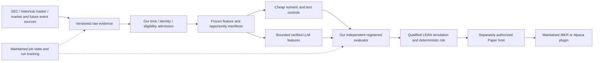

# Long-term trading/research build-versus-adopt audit

**Recommendation:** retain a small scientific control layer; adopt standard data,
model and workflow tools; integrate **LEAN** as the first simulation and future
broker engine to qualify. Use **NautilusTrader as the alternative to benchmark**,
not a second engine to operate. Keep agent frameworks in an isolated research
role. Do not replace the project with TradingAgents, RD-Agent or FinRL-X.

If starting from zero today: a qualified maintained historical reference source
+ SEC original documents → immutable evidence and temporal admission →
Parquet/DuckDB → scikit-learn controls and one removable structured LLM extractor
→ an independent registered evaluator → a qualified LEAN adapter → a separately
authorized execution host with its maintained IBKR/Alpaca plugin. Track trials
with MLflow. Start with local storage and bounded commands; use Prefect for
durable unattended jobs when needed, rather than writing a scheduler.

This audit authorizes **no installation, migration, experiment, data purchase or
execution**. FMBH remains UNRESOLVED. Amendment 005, registrations, ledger,
candidate priority, broker flags and trading-disabled state are unchanged.
Snapshot: `ad45afbf9aa1de402926b0a84da3e914faae5bd1`. User-facing date:
October 18, 2026, Asia/Jerusalem; actual source captures retain UTC timestamps.

## Evidence and changes from the previous audit

Inspected maintained implementation paths, tests/configuration, licenses,
dependency declarations, Git commits/tags, GitHub release metadata and PyPI
metadata. Public documentation requests were read-only. No third-party framework
was installed, imported, benchmarked or run. No generated agent code was executed.
The [source packet](audit/20261018/README.md) preserves pins, hashes, quotations,
release observations and failures. Findings below describe the inspected paths,
not every possible configuration of a project. Stars were not selection evidence.

Material corrections/additions to `BUILD_VS_ADOPT_20261017.md`:

- Current TradingAgents implements meaningful as-filed SEC, vintage FRED,
  publication-date filtering and durable checkpoints. It is inaccurate to dismiss
  its historical mode as simply admitting all current news/fundamentals.
- Qlib **Git release v0.9.8** already includes restricted recorder loading despite
  stale “unreleased” README wording. PyPI still publishes 0.9.7; those are different
  artifacts. Qlib genuinely supports PIT revision storage and training-only fits.
- RD-Agent has signed sessions and resume. Its inspected factor code nevertheless
  executes on the local host, and iterative feedback uses its nominal test period.
- The official FinRL-X repository is **AI4Finance-Foundation/FinRL-Trading**.
  It is a substantial implementation, with concrete correctness gaps below.
- LEAN's open engine license does not establish free official broker connectivity.
  Its official IBKR/Alpaca plugins validate QuantConnect module licenses. Default
  terminal liquidation also conflicts with the registered outcome contract.
- Nautilus stable 1.x and its developing 2.x Rust rewrite must not be treated as
  the same runtime. A new integration needs a support/migration decision.
- Long-running research needs maintained job orchestration and versioned inputs;
  a conversational agent's memory is insufficient.

## 1. Framework decisions

`ADOPT`: use an upstream implementation instead of building it. `INTEGRATE`:
connect a maintained component through a small contract adapter. `BENCHMARK`:
candidate for a later separately authorized comparison, with no scientific or
trading authority. `KEEP_OURS`: retain project-specific semantics and controls.
`REJECT`: do not use the identified component/default as our backbone. These are
architecture decisions; conditional integrations are not dependencies added now.

| Framework | Primary decision | Useful capability | Why this disposition |
| --- | --- | --- | --- |
| TradingAgents | **BENCHMARK** | Multi-source analyst graph, typed reports, as-filed SEC filtering, macro vintages, resumable analysis and provider routing | Its daily decision/rating experiment, historical identity and evidence retention differ from the registered MD&A/NBBO/paired-control experiment. A debate hierarchy adds a new hypothesis and cost. |
| Microsoft RD-Agent(Q) | **BENCHMARK** | Autonomous factor/model proposal, coding, evaluation, feedback and checkpoint/resume | Strong future discovery assistant; unmodified test feedback contaminates a final test and local generated-code execution needs external isolation. Does not clear acquisition gates. |
| FinRL | **BENCHMARK** | Established RL environments, algorithm wrappers and saved training state | RL is a separate research question. Inspected cleaning/selection and simplified reward/fill paths cannot supply the current evaluation contract. Low priority. |
| FinRL-X / FinRL-Trading | **BENCHMARK** | Weight-centric strategies, ML learners, historical-index helpers, caching, configurable bt costs and real Alpaca execution | Full-frame transforms, availability joins, destructive history replacement and exposure normalization require material changes. No verified IBKR route in inspected source. |
| Qlib | **BENCHMARK** initially | PIT data storage, feature expressions, fitting windows, models, dataset handlers, experiment recorders and daily portfolio research | Valuable reusable research infrastructure, but supplied collectors, labels, execution defaults and universe inputs are not our registered evidence. Integrate selected pieces only if they reduce actual work. |
| QuantConnect LEAN | **INTEGRATE**, first engine qualification | US-equity lifecycle, mapping/actions, portfolio/accounting, orders, fill/fee/slippage hooks, maintained broker plugins | Best current functional fit among inspected engines, conditional on exact contract fixtures, delisting interception and commercial broker-plugin terms. Our data/evaluator remain external authority. |
| NautilusTrader | **BENCHMARK**, alternative engine qualification | Deterministic event-driven backtest/live architecture, cache/catalog, OMS/risk/reconciliation and IB support | Strong execution design; US class/corporate-action semantics need qualification and 1.x→2.x migration is material. Do not fund two production engines. |
| FinGPT | **BENCHMARK** extraction/model candidates | Financial task models and tuning recipes | Model/data licenses, weight contamination, Forecaster methodology and Python compatibility make it unsuitable as our evidence/evaluation authority. |
| vectorbt | **BENCHMARK**, optional rapid numerical screen | Efficient array simulations and parameter sweeps with configurable costs | Execution ordering/OHLC assumptions differ; fast sweeps still consume registered trials. License includes Commons Clause, not plain permissive Apache. |
| Zipline-reloaded | **BENCHMARK**, low priority | Maintained asset bundles, adjustments and event-driven US-equity research | More relevant than abandoned original Zipline, but another simulator adds little to the selected path. Does not supply a verified class master or a maintained end-to-end IBKR path merely through asset bundles. |
| QuantRocket | **BENCHMARK**, commercial shortlist | Consolidated US history including delistings, PIT ticker rows, as-reported fundamentals, Pandas/Moonshot/Zipline research, IBKR/Alpaca operations | Could replace substantial data/engine/broker plumbing. Proprietary internals, unverified paid price and included-data retention restrictions prevent default selection. Qualify against LEAN plus data if a commercial bundle is desired. |
| Backtrader | **REJECT** as a new backbone | Flexible historical event engine and commission/slippage/filler interfaces | Inspected maintenance stops in 2023; IB adapter uses legacy IbPy; GPLv3 and modernization burden add avoidable cost. Preserve useful reference knowledge, not another deployment. |
| Freqtrade / Jesse | **REJECT** for this scope | Maintained crypto strategy/execution workflows | Wrong default market/data/broker model for the US-equity/SEC/IBKR objective; no demonstrated advantage that justifies adaptation. |

### TradingAgents: useful current improvements, different experiment

At `e8f5503e9b86d5c2710b0c76b1f686703968c9df` / v0.7.0:

- `sec_edgar.py` filters companyfacts by **filed date** and selects filed vintages
  rather than blindly treating fiscal period-end as availability. Its CIK resolver
  still uses today's `company_tickers.json`; same-date filing ordering and cutoff
  are not acceptance/receipt-time precision. Its replaceable JSON cache is not our
  original-accession MD&A evidence store. [T01–T02]
- FRED queries pin realtime bounds to the requested date. News/social tools filter
  publication timestamps and report some coverage gaps. These are real causal
  improvements. They do not recover complete original historical article versions,
  reception times or all missing stories. Historical prompts can still include
  the **current company name**, and identity lookup can fail open. [T03–T07]
- SQLite graph checkpoints and config/portfolio signatures support actual resume.
  The evaluator explicitly evaluates decision quality rather than a full portfolio
  simulator. Its subsequent-close entry convention and rounded rating alpha differ
  from registered first-valid-quote execution and incremental C-minus-control net
  performance. Checkpoints can resume a different source vintage unless the
  evidence/model release is separately frozen. [T08–T16]

**Can it accelerate alpha testing?** It accelerates a generic daily analyst demo
and provides useful collector/test patterns. It does not accelerate the current
blocked acquisition path enough to justify a wholesale adapter. The first C arm
needs one bounded source-grounded extractor, not analyst/trader/risk debates.
Benchmark the entire graph only as a separately registered competing strategy.
An LLM risk recommendation never authorizes an order.

### RD-Agent(Q): adopt the discovery capability through a future benchmark

At `484776c211e4fbbeef03e0ec00d6bbee7362a4f4` / v1.0.0:

- It already implements proposal → code → run → feedback, finite loop/step/time
  options and session loading. HMAC-signed sessions reject unsafe unsigned legacy
  pickles by default. Do not rebuild this generic research loop. [R11–R17]
- The default factor template backtests the **test** segment. Test-period excess
  return/drawdown are returned to the next hypothesis and “replace best” decision.
  That makes the named test **selection data**. Full-sample factor correlation
  deduplication can also let future feature distributions affect retained factors.
  Merely renaming YAML splits cannot create an untouched holdout. [R01–R05]
- `FactorFBWorkspace.execute` launches generated `factor.py` with a local shell
  subprocess and inherited environment. The separate Qlib Docker runner is not
  an outer security boundary for that local step. Docker defaults include network
  access and writable workspaces; supplied environment values can be logged.
  HMAC persistence does not sandbox generated code. [R06–R10, R15–R16]

**Can it accelerate alpha testing?** Yes, later factor/control discovery and
implementation trials can be much faster than inventing a new coding researcher.
It cannot solve source admission, nor may it access the confirmatory test or
promote itself. Use a disposable isolated worker, training/validation-only inputs,
an external cumulative trial/cost ledger and independent causal checks. Count all
generated variants, failures and repairs. Its published cheap-run/ARR claims are
not our measured cost or evidence of US-equity incremental alpha.

### Qlib: real PIT capability does not certify the supplied data

At `54355232463878d2eebb91fe0ee5fa7fa1f5976c` / Git v0.9.8:

- PIT operators and storage distinguish reporting periods, publication dates and
  linked revisions. Fitting processors accept training windows; official examples
  fit only training data. Claims that Qlib necessarily lacks PIT or always fits
  globally would be wrong. [Q02, Q05–Q09]
- Its inspected Baostock collector substitutes 45/90-day publication lags when
  dates are missing. Its Yahoo collector uses adjusted-price factors; US index
  helpers include Wikipedia-derived changes and convenience symbol lists. These
  inputs do not establish our raw/as-filed timing or complete historical classes.
  The README's official dataset download is temporarily disabled and points to
  community data. [Q03–Q04, Q10–Q12, Q18]
- Negative `Ref` shifts are legitimate **labels**, not admissible feature operators.
  Default Alpha158 labels and top-k close-price backtests are different from this
  event experiment. Restrict feature operators and fit scope; qualify future-data
  invariance rather than trusting a library name. [Q08–Q09, Q17]
- Git v0.9.8 recorder loading defaults to a restricted unpickler. Captured v0.9.7
  recorder uses unrestricted pickle; PyPI still serves 0.9.7. Current Qlib also
  requires `mlflow<3.13`, whereas the standalone current release is 3.17.1. Keep
  an isolated qualified environment rather than downgrading acquisition/CI or
  mixing incompatible tracking packages. [Q13–Q16]

Start with directly adopted scikit-learn models. Consider Qlib only when its
dataset/cache/factor machinery saves more than the adapter and runtime cost.

### FinRL and FinRL-X: concrete adoption costs

FinRL-X (`4409abe925c904e570be78ebfb5e77ac3491dff8`) has useful historical S&P
membership helpers, ML composition and configurable bt cost models. It is not
fairly described as just a toy notebook. Nevertheless, inspected paths:

- `ml_strategy.py:625` imputes medians and drops constant features across the
  supplied frame **before** constructing date masks at line 684. Its later
  train-only scaler does not remove the earlier leak.
- `data_fetcher.py:901` stores filing/accepted dates but truncates accepted time;
  downstream ML uses fiscal-quarter `datadate`, not demonstrated historical
  availability. `data_store.py:985` uses `INSERT OR REPLACE` for fundamentals.
- `backtest_engine.py:156` divides weights by their positive row sum: a long-only
  target with **60% gross becomes 100%**, overriding cash/exposure semantics.
- `alpaca_manager.py:391` defaults `dry_run=False` and has real cancellation/order
  paths. Paper defaults are still broker writes, outside our coding/research host.

FinRL classic (`8511e7c15fbe1fbe5eb25e9f89932ac1ecd546a0`) supplies legitimate
Gym/RL wrappers and checkpoints. Its inspected cleaning drops instruments with
missing data anywhere in the sample and uses global forward/backward filling.
Future availability can select the sample or fill earlier observations. Portfolio
value rewards and percentage costs are not our paired registered objective.

FinGPT Forecaster's main split is chronological, but its utility has a random
fallback, repeated test-set evaluation and fiscal-period availability assumptions.
Hindsight-conditioned teacher rationales are training labels, not ex-ante evidence.
Current package requires Python **<3.13**. Use a separately qualified extraction
model if it wins; do not adopt that forecasting pipeline or loosen our runtime.

### LEAN: first integration target, with explicit admission conditions

Use LEAN's existing universe/event, corporate-action, portfolio, order and broker
infrastructure rather than extending `replay.py` into a general engine. Keep our
historical population and evidence bindings external. LEAN SID/map files help
simulation identity; they do not establish complete issuer-class eligibility.

Its default fills/fees/slippage/risk models are implementations to configure or
replace through supported interfaces, not calibration or a proof of execution
quality. Required qualification includes native quote precision, scheduled delay,
bid/ask/conditions/size units, 10% depth cap, minimum fees, halts, partial fills,
cash reservations, raw prices/actions and actual terminal outcomes.

**Important default:** the inspected delisting path can synthesize a full fill at
`security.Price` with zero fees. That violates the registered actual-treatment
rule. A source-level extension route exists through virtual setup/brokerage
notification hooks before the transaction handler. Static feasibility is not a
tested integration: a plugin must intercept fallback fills, preserve unresolved
holdings, and admit actual settlement/outcome evidence. Existing universe removal
and cancellation side effects also need fixtures. Never drop delisted events to
make the engine pass. Reject a route needing an enduring core fork.

**Important commercial boundary:** official IBKR and Alpaca plugins call
`ValidateSubscription`, authenticate QuantConnect module-license requests and
validate expiration. The open engine is Apache-2.0; the entire official broker
route is not thereby proved subscription-free or independent of QuantConnect
license services. Confirm exact module entitlement/rights before integration.
Use one maintained engine/connector, not a new custom IBKR order stack to evade
this issue. Scientific data and decision evidence stay portable if execution
software is later replaced.

Nautilus is the credible alternative if LEAN's hooks, licensing or runtime burden
fail qualification. It has genuine risk/OMS/reconciliation/IB facilities, but its
1.x maintenance transition and US-equity corporate-action/identity gaps require
their own test. A Rust engine or a deterministic event loop is not a complete
historical equity security master. Do not install a moving 2.x HEAD and attribute
all of its capabilities to a stable 1.x wheel.

## 2. Disposition of each major subsystem

| Subsystem | Decision | Maintained implementation and our minimum responsibility |
| --- | --- | --- |
| Evidence/provenance admission | **KEEP_OURS** | Retain raw-byte hashes, clock distinctions, accession/class bindings, append-only decisions and fail-closed semantics. Use standard SQLite/object storage; do not grow a proprietary database platform. |
| Historical security master | **INTEGRATE** | Qualify a maintained reference backbone as in the red review; retain small temporal crosswalk/admission adapters. Buy maintenance of the universe rather than recreate it from current symbols/ITCH. No vendor is newly admitted here. |
| Eligibility/cohort/registration | **KEEP_OURS** | Preserve registered population/class selection, exact lookbacks, protected hashes, unresolved states, candidate ordering and no-replacement rules. |
| SEC discovery/transport | **INTEGRATE** | Retain bounded original-envelope capture and completeness guards; use SEC APIs and maintained HTTP tooling. No current-ticker lookup as historical identity. |
| SEC/XBRL/document parsing | **ADOPT** | EdgarTools for parsing/crosschecks from captured accession-bound data after acceptance fixtures. Keep our raw-span/period/entity verifier; stop building a universal SEC/XBRL parser. |
| Market/reference source transport | **ADOPT** | Official qualified provider SDKs/bulk tooling, keeping native symbols/time/precision and raw-response evidence where required. Source contracts/entitlements remain independent of engine defaults. |
| Macro/government/news collection | **INTEGRATE** | Official agency APIs/archives, ALFRED vintages and a qualified historical news source; source-specific availability/revision adapter beneath the same evidence layer. No autonomous browsing-to-trade shortcut. |
| Numerical feature/model pipeline | **ADOPT** | scikit-learn Pipeline, Ridge and the registered squared-loss depth-2 boosted-tree implementation/grid. Fit preprocessing only on training rows. Use existing numerical libraries, not custom ML estimators. |
| Cheap text and verified extraction | **KEEP_OURS** | Registered shared passages, deterministic comparisons, source-span/entity/unit checks, schema validation and abstention. Adopt ordinary parser/model SDK primitives underneath. |
| LLM inference/provider transport | **ADOPT** | Official model clients and structured output validation. One bounded extractor plus permitted repair; no generic multi-agent framework needed for a fixed extraction stage. Model choice remains removable. |
| Hybrid strategy composition | **INTEGRATE** | LLM facts become reviewed features in the same estimator/risk pipeline as controls. Preserve fixed opportunities, models, budgets and information boundaries. Avoid vote-based trade committees. |
| Automated factor discovery | **BENCHMARK** | RD-Agent(Q)/Qlib in an isolated later research experiment. Do not custom-build a proposal/code/evaluate/repair loop. |
| Experiment metrics/artifact index | **ADOPT** | Local/private MLflow; log all trials/failures/costs and link immutable input/registration hashes. Mutable tracker rows are not scientific authority. |
| Data/model artifact lineage | **ADOPT** | DVC/content-addressed manifests and private versioned storage when scale needs it. Evidence timing/rights remain separate; do not commit licensed data. |
| Analytical storage | **ADOPT** | Parquet and DuckDB views over versioned evidence/features. Preserve quote precision and temporal joins; no new feature-store service yet. |
| Backtesting and portfolio accounting | **INTEGRATE** | Qualified LEAN adapter, including registered fills/costs/terminal treatment. Retain the tiny existing replay only as a regression oracle. |
| Statistical/economic evaluator | **KEEP_OURS** | Registered paired incremental net metric, controls, purging/grouping, failures/abstentions, trial budgets, holdout and promotion rules. Adopt statistical/bootstrap primitives. |
| Portfolio allocation/risk implementation | **INTEGRATE** | Maintained engine accounting/reservations/risk hooks; retain our exact deterministic limits, halt and scheduled-exit policy. Prototype defaults are not the registered production policy. |
| Order lifecycle/OMS | **ADOPT** | Selected engine's order states, partial-fill/cancel handling, dedup/reconciliation capabilities. Keep only a small project approval/intent boundary and acceptance checks. Do not build a generic OMS. |
| Broker connectivity / future IBKR | **INTEGRATE** | Maintained selected-engine plugin after license, Paper and fault-recovery qualification. Existing read-only broker probes remain diagnostics. |
| Monitoring/reconciliation | **INTEGRATE** | Engine reconciliation plus standard metrics/logging/OpenTelemetry. Keep source/economic/cost/unknown-state alerts. A successful snapshot is not continuous reconciliation. |
| Research job checkpoint/resume | **ADOPT** | DVC stages for dependency/cache reuse; Prefect for durable scheduled retries/pause/resume when unattended work requires it. Never implement a generic scheduler or confuse cache reuse with scientific replay. |
| Agent graph state | **BENCHMARK** | Use a framework's checkpointing, or LangGraph if a new bounded graph is genuinely needed. No second graph engine in the minimal fixed extraction path. |
| GitHub coding/review automation | **INTEGRATE** | Existing official-runner qualification plan, trusted-base guards, exact-SHA CI and independent review. Current real-provider activation remains PAUSED_BUDGET; no new agent platform/router. |
| Secrets/security | **ADOPT** | Platform secret isolation, least-privilege jobs, locked dependencies/containers and sandbox controls; keep project-specific access/cost/approval policy. No broker/acquisition secrets in research coding agents. |

## 3. Evaluation against the eighteen end-goal requirements

| Requirement | Recommended path and practical limit |
| --- | --- |
| 1. PIT/no-lookahead | Our evidence admission + qualified data + training-only pipelines. Qlib/TradingAgents have useful PIT implementations but do not certify source quality or model-weight knowledge. |
| 2. Survivorship-safe universe | Maintained historical master with delisted/classes/changes; reviewed historical manifests. Engine universe support is capability, not a populated complete universe. |
| 3. SEC/as-filed fundamentals | Original accession-bound filings/contexts and accepted/observed clocks; EdgarTools parsing. Do not join by fiscal period end or silently prefer later restatements. |
| 4. Macro/Fed/government/regulation/news | Versioned event/source records with publication/receipt and vintage semantics; later separately registered inputs. Detailed flow below. |
| 5. Quant baselines | Direct scikit-learn controls and deterministic numerical/text features. No RL or autonomous factor search needed for the first registered comparison. |
| 6. AI/LLM strategies | Bounded verified extraction first; TradingAgents/FinGPT only separately qualified comparators. Freeze provider/model/prompt and count failures/costs. |
| 7. Hybrid strategies | Same downstream statistical policy with additional verified features. Same opportunities and costs; remove C if it loses. |
| 8. Factor discovery | RD-Agent/Qlib can save implementation work after authorization. Only training/validation visible; finite cumulative search budget and independent reproduction. |
| 9. Realistic simulation costs | Engine fill/cost extensions plus our quote/deadline/size/halts/outcome admission. Neither flat commission support nor an equity curve proves realistic costs. |
| 10. Portfolio/risk | Engine accounting and deterministic registered allocation/limits; explicit pending cash/shares, stale-state rejection and restart-safe halt. |
| 11. Paper/live | Separate future approval and execution host. Simulation success grants neither capability. All current flags remain disabled. |
| 12. Broker independence / IBKR | Research identity/decisions independent of broker symbols; maintained connector behind engine interfaces. IBKR contract mapping/account reconciliation are execution concerns. |
| 13. Provider independence | Owned raw evidence/release manifests and normalized portable outputs; qualified adapters. Frozen Alpaca liquidity semantics cannot be swapped without a future amendment. |
| 14. Autonomous long jobs | Maintained workflow state/results + immutable input manifests + finite budget/resume checks. Checkpoints do not make external calls exactly-once. |
| 15. Incremental AI alpha | Our independent registered evaluator, strong cheap controls, equal opportunity set, untouched test, all costs and prospective confirmation. No inspected framework supplies this whole contract. |
| 16. Licensing/cost | Pin exact artifact/license, separate code/data/model/broker/hosted-service rights; current observations below. Avoid unqualified recurring commitments. |
| 17. Security/operations | Isolate generated code and hostile documents; private tracking/storage, secrets segregation, explicit egress/resources, single broker writer, reconciliation after ambiguous outcomes. |
| 18. Maintenance/activity | Recent versions and real code/tests matter. Distinguish Git/PyPI/dev branches, archived/legacy routes, platform declarations and actually tested compatibility. |

## 4. Government, macro and news belong in the evidence plane

These are **future source families**, not additions to the current registered
10-Q experiment. They share the scientific data boundary; they are not a new
autonomous analyst with brokerage tools.

| Source family | Ingestion and temporal treatment | Cheap control and potential LLM role |
| --- | --- | --- |
| Macro data: FRED/ALFRED, BLS, BEA | Preserve series/observation period separately from release vintage, actual publication instant, receipt and revisions. ALFRED realtime periods are date-granular and default to today unless specified. First-release values still require release-time corroboration for intraday decisions. | Calendar/release/value/change controls first. Surprise requires an archived pre-release consensus source; not a later consensus estimate. LLM may extract qualifications or narrative beyond numbers. |
| Fed statements/minutes/speeches | Archive original document/version, announcement/meeting time, first observation and amendments separately. A meeting calendar does not prove a statement was public at a scheduled second. | Rate decision/changes and deterministic text differences first; bounded source-grounded language features later. |
| Regulations, agency actions, enforcement | Agency releases + Federal Register/public-inspection record and authoritative linked documents where relevant. Proposal, publication, adoption, legal effective date and enforcement date are different events. | Structured agency/action/entity/exposure controls; LLM can parse obligations and affected businesses with source spans. |
| News/issuer releases | Licensed historical archive or prospectively captured raw story versions, publisher/story IDs, publication/receipt/update/retraction clocks, duplicates and coverage gaps. Current search with a date filter does not recreate a historical wire. | Counts, topic/term changes and numeric facts first; sentiment/event extraction only if incremental. Never use later corrected text at the original timestamp. |

Source-grounded entity links map an event to an issuer/class/exposure **using
information available then**. Today's company profile, sector or supply-chain
graph can itself leak. Preserve one-to-many links and uncertainty. Freeze event
definitions and feature windows before testing; do not retroactively select only
stories an LLM found interesting or industries that later moved.

FRED's official docs explicitly distinguish today's revised view from historical
ALFRED vintages. Maintained `fredapi` has all-release/as-of helpers; it is an
independent Apache-2.0 client, not an official Fed SDK. Its inspected as-of helper
returns **all revisions up to the date**, so callers must select the appropriate
last admissible vintage per observation rather than assume a unique latest row.
Use existing transport/query libraries; keep the small source-specific semantic
adapter. BLS/BEA API availability does not alone establish an as-known archive.
FederalRegister.gov documentation also warns about legal-status verification;
retain authoritative documents when claiming a legal effective fact.

No new agency/data API collection was performed; only documentation was inspected.
The Fed calendar origin returned 403, while SEC/FRED/BLS/BEA/Federal Register docs
were accessible. Do not repeat the previous audit's broad network restriction as
a current observation or infer historical completeness from a reachable site.

## 5. Research autonomy and checkpointing without a custom platform

For the first admitted experiment, one worker executing explicit stages is enough:
capture → verify → freeze inputs → train controls → extract/verify → evaluate.
MLflow indexes runs; DVC can cache/version stages. The evidence store retains
source truth, not the workflow engine. No Kubernetes, vector database, distributed
feature store or persistent team of trading agents is justified by current scale.

For unattended long-running acquisition or research, **adopt Prefect** state,
retries, scheduling and persisted results. Its actual suspend/resume code requires
a deployment and persisted results; a pause does not cancel already running tasks.
Configure private durable storage and deterministic task/input IDs. Resume only
the same frozen evidence/model/config or create a new registered run version.

Keep our budget/repair/permission rules outside generated code. Reserve sufficient
budget before launching a cost-bearing task, record actual cost, preserve usage
across retries/resets and pause when unknown/exhausted. A workflow retry must not
silently repeat a non-idempotent provider or broker request. No inspected graph
checkpoint promises provider billing enforcement or broker exactly-once behavior.

RD-Agent's own research session loop and TradingAgents' own graph checkpointing
should be reused inside their isolated workers if benchmarked. Do not wrap each
with another custom imitation. Prefect may supervise a coarse worker job; it need
not understand every internal LLM message. Export reviewed features/code through
a strict artifact boundary, never Python pickles from an untrusted worker into
the trusted process. A signed artifact authenticates a writer, not scientific
causality or harmless code.

GitHub remains source of truth for code/policies/registered decisions. Development
agents implement bounded issues and receive independent review plus mandatory
tests and human merge approval. Research workers cannot self-amend science,
merge code, unlock a final holdout, or obtain broker credentials.

## 6. Clean path to future IBKR execution

1. Finish the existing source/acquisition gate; this audit neither changes its
   status nor runs alpha. Freeze portable admitted manifests and reviewed model
   outputs before evaluating strategy value.
2. Qualify a pinned LEAN build with synthetic contract fixtures **before** using
   it for registered performance. Include delayed valid NBBO, capacity, exposure,
   halts, splits/mergers/delistings and unresolved terminal outcomes. Use supported
   plugins/configuration rather than a maintained engine fork.
3. Confirm official IBKR adapter commercial entitlement, TWS/Gateway/API license
   and platform support. Resolve research instrument → historical listing →
   broker contract/conId mapping with evidence. `SMART` is routing, not a historical
   primary-listing or legal-class assertion.
4. After separate authorization, run isolated Paper execution with exact account
   allowlisting, one writer, stale/unknown-state blocking, persisted order intent,
   broker IDs/execution IDs, partial-fill/cancel/timeout reconciliation and a
   controlled halt/reset. Reconnect by querying authoritative orders/positions;
   never blindly resubmit an ambiguously acknowledged order.
5. A later live gate requires its own operational and scientific approvals.
   Paper fills do not prove live queueing, market impact, halts or profitability.

Our present IBKR module is a read-only diagnostic with order methods blocked; it
is not an OMS starter to expand. The maintained engine plugin handles generic
order lifecycle. Our small external gate owns strategy authorization and limits.
If LEAN integration requires extensive patches or unacceptable licensing, qualify
Nautilus as the alternative; do not write another IBKR client to preserve a prior
framework choice.

### Commercial alternative: QuantRocket

This is a serious alternative to assembling several generic services ourselves.
Official documentation describes consolidated EOD/minute US data since 2007,
delisted securities and historical ticker symbols, separate from the current
securities-master Symbol. It distinguishes Sharadar as-reported AR dimensions
from most-recent/restated MR dimensions, and documents shifting DATEKEY one day
for daily availability. Those are useful capabilities, not proof of exact SEC
acceptance/receipt or class-completeness semantics.

Its actual client exposes broker order placement, collection resume and Gateway
operations. It could accelerate future IBKR/Pandas research more directly than an
LLM agent framework. However, minute trade bars do not satisfy the NBBO/depth/status
contract, and its Zipline documentation explicitly disables commissions/slippage
by default. A commercial service API is not inspection of the proprietary engine.

Current paid pricing is login/classification gated; **do not substitute old quoted
prices**. The Apache-2.0 client license does not cover proprietary services. The
captured EULA restricts included-data use after subscription cancellation, which
is material for permanent evidence/reproduction and exit. Request written retention
and replay rights plus total data/broker/runtime costs before a procurement
comparison. The free tier offers samples, not Paper/live trading. No account,
data download or purchase was made. See the persisted QuantRocket evidence.

## 7. What remains ours, what stops now, and simplicity

**Uniquely necessary responsibility:** our specific scientific contract and its
evidence-backed enforcement—not a claim that every line of our storage/transport
code is irreplaceable. Keep registrations, raw/source-span provenance, temporal
identity/eligibility admission, candidate ordering, common-opportunity evaluation,
untouched tests, failure/abstention accounting and exact deterministic safety
policy. These remain necessary even when data, models, scheduling, storage and
execution implementations are adopted.

Keeping our policy does not certify today's prototypes. `risk.py` currently
defaults to 80% gross/20% symbol and blocks sells under its halt, whereas the
registered research policy uses different limits and preserves scheduled exits.
The local intent ledger is not broker exactly-once submission. Preserve these
files and their regression meaning now; qualify the later policy overlay instead
of presenting either prototype or framework defaults as production-safe.

**Stop building immediately:** a generic backtester, OMS, broker HTTP stack,
security master, universal SEC parser, model library, scheduler, experiment tracker,
factor-generation coding loop, multi-agent debate hierarchy or cross-provider
router. Stop extending prototype risk/accounting into a general engine. Retain
registered old code and regression oracles; “stop building” does not mean delete
protected implementations or erase old results.

The simplest credible deployment is a private Python research worker and evidence
store, plus **one** qualified engine/execution process later. Add MLflow at the
first authorized model stage; DuckDB/Parquet and DVC when dataset size warrants;
Prefect when jobs must survive unattended failures. No agent framework is required
for the initial experiment. A single structured extractor remains an ordinary
replaceable function behind evidence and cost gates.

Provider/broker interfaces never feed current asset lists back into historical
truth. The framework is replaceable. An LLM that fails the net incremental test
is removed without requiring a new execution or evidence platform.

## 8. Current releases, maintenance, compatibility and licenses

These are observed source/package facts, **not installed compatibility results**.
Published Python bounds are necessary but not sufficient; native wheels, external
binaries and dependency locks still need qualification. Keep specialized engines
and research workers isolated rather than weakening the repository's Python 3.13
CI. Do not install development HEAD merely because it was inspected.

| Component | Current observation | Code license / compatibility / maintenance consequence |
| --- | --- | --- |
| TradingAgents | Git/GitHub v0.7.0, October 16, 2026; HEAD equals tag | Apache-2.0; Python >=3.11. Active tests include as-of/news/checkpoint behavior. No PyPI package version established by the queried route. |
| RD-Agent | Git/PyPI v1.0.0, September 23, 2026 | MIT; Python >=3.10. Active factor/code/session tooling; external execution boundary still required. |
| Qlib | Git v0.9.8 October 8, 2026; PyPI 0.9.7 August 2025 | MIT; source Python >=3.8, but current dependency constraints and exact security behavior differ by artifact. Do not assume 3.13 working from the lower bound. |
| FinRL | Git v0.3.8; HEAD October 13, 2026 UTC; PyPI 0.3.7 | MIT; broad native/ML/broker dependencies. Python metadata is not proof of current-stack reproducibility. |
| FinRL-X | HEAD September 18, 2026; GitHub v1.0.0 March 2026; setup/PyPI 2.0.2 with older upload | Apache-2.0; Python >=3.11, Docker 3.11. Version signals differ; no checked-in tests/workflows found in the inspected snapshot. Qualify exact commit/container, not a product name. |
| LEAN | HEAD/build tag 18192, October 16, 2026 | Apache-2.0 engine; .NET 10, documented Python 3.11.11/Python.NET environment. Latest GitHub semantic release is stale 2017 metadata, not evidence of abandonment. Maintained IB/Alpaca plugins have additional license-service dependency. |
| Nautilus | Stable/PyPI 1.231.0 August 2, 2026; HEAD 2.0.0rc8 October 17, unreleased | Stable LGPL-3.0-or-later vs HEAD LGPL-3.0-only; stable Python >=3.12,<3.15 with cp313 wheels, HEAD >=3.13,<3.15. Final legacy 1.x line, limited post-cutover security-backport window. Do not start an indefinite new 1.x dependency. |
| FinGPT | HEAD September 23, 2026; GitHub v1.0.0 April 2026; PyPI 0.0.1 from 2023 | MIT code; setup Python >=3.8,<3.13. Models/data and remote-code trust are separate licenses/security decisions. |
| vectorbt | Git/PyPI 1.1.2 October 9, 2026; HEAD October 15 | Apache-2.0 **with Commons Clause**; source-available restriction on selling software/services; not plain permissive OSI licensing. Python >=3.11,<3.15 and 3.13 CI declared. |
| Zipline-reloaded | PyPI 3.1.1 July 2025; current pinned maintained fork | Apache-2.0; Python >=3.10. More relevant than original Quantopian Zipline; no new parallel deployment recommended. |
| Backtrader | HEAD and PyPI 1.9.78.123 April 19, 2023 | GPLv3; legacy IbPy integration and old Python declarations. New modernization work is unjustified for this stack. |
| QuantRocket | Public client 2.11.0.0 December 2024; client HEAD November 2024; current official service docs inspected | Apache-2.0 client, proprietary services/EULA. Client age does not date private service maintenance. Current paid engine release/support/Python guarantees remain unverified. |
| EdgarTools | PyPI 5.62.0 October 11, 2026 | MIT; package Python >=3.10 vs inspected development source >=3.11. Adopt parsing after fixture checks, not its cache as original evidence. |
| MLflow | PyPI/GitHub 3.17.1 October 13, 2026; HEAD 3.17.2.dev0 | Apache-2.0; >=3.10. Use private tracking and trusted model artifacts. Qlib's current <3.13 constraint requires isolation. |
| Prefect | PyPI/GitHub 3.8.8 October 6, 2026; stable pause/suspend source also inspected | Apache-2.0; Python >=3.10,<3.15. Self-hosting avoids mandatory SaaS fees but not operational/storage costs. |
| DVC / DuckDB / scikit-learn | PyPI 3.67.1 / 1.5.6 / 1.9.1 | Apache-2.0 / MIT / BSD-3-Clause. Published Python >=3.9 / >=3.10 / >=3.11; scikit-learn development HEAD requires >=3.12. Pin releases and use existing functionality. |
| fredapi | PyPI 0.5.2 May 2024; repo not archived, pushed January 2026 | Apache-2.0; community wrapper, not an official Fed SDK. Its narrower release cadence is acceptable for a small optional adapter, not grounds to treat its outputs as complete intraday evidence. |

Full pins are in the source manifests. Important additional pins: LEAN IB plugin
`fb86123c7ea07c3e9d02d56ed7476675e3e4578a`; Alpaca plugin
`f186471dc3a9b349e516a69fd75a603ffb5e1050`; Nautilus HEAD
`68bcfc778cf1635ee26e96225b2cb596b721c8cb`, stable
`27a8e54e7ac3c57d6cbf8891f0283dfbaee97317`; QuantRocket client
`b5c7aca2f9bc1d9532551d3c03692ead129d4f55`.

Nautilus stable IB integration uses repackaged official Python `ibapi`
(`nautilus-ibapi`), not ib_insync/ib_async. Its 2.x implementation uses an independent
Rust IB client. The engine's LGPL license, Rust client's MIT license and IB's
API/account/data licenses are distinct. Confirm actual intended use and distribution
terms; do not assume a noncommercial/commercial classification from a library name.
No broker login or license check was performed.

Security maturity remains bounded by configuration and deployment. Neither active
releases nor HMAC/restricted pickle features make hostile code/documents safe.
Generated code runs in a disposable resource-limited no-secret environment; no
acquisition store, broker keys or final-test data mounted there. Apply network
allowlists, private tracker/storage authentication and pinned artifact provenance.
No repository-wide CVE scan or upstream binary/runtime validation was performed.

## 9. Costs, migration order and concrete decision gates

| Stage | Expected cost/complexity | Required decision |
| --- | --- | --- |
| This audit and source qualification | $0 purchases, paid provider/model API calls and subscriptions. Existing included development usage; engineering time is not free. | Keep current scientific gate/status. Documentation does not enable any provider or framework. |
| First admitted controls | scikit-learn/MLflow/local storage: $0 software license fees; modest CPU/storage, measured on actual workload | Introduce only after the existing acquisition gate and authorization. No simultaneous RL/agent/factor infrastructure migration. |
| Workflow/data tooling | DVC, DuckDB, Prefect self-host: $0 software license subscription; storage/compute/backups and operator time remain | Add one tool for a demonstrated need, not every proposed component at once. A single worker precedes a workflow service. |
| LEAN qualification | Planning estimate 3–7 engineer-days for an offline fixture spike; 1–3 more weeks for a usable bounded integration if it passes | Reject extensive core forks. No runtime qualification or performance claim has been executed here. |
| LEAN official CLI/connectors | Public Researcher Seat $10/month or $96/year; Researcher Pack $84/month or $888/year. These are different products. Exact IB module 181 / Alpaca module 347 entitlement prices and full stack minimum are **unknown**. | Obtain exact terms. Do not present seat/pack pricing as a verified all-in broker license. Compute/data/platform services add costs. |
| Nautilus alternative | No core license subscription for permitted LGPL use; substantial integration/migration/security labor, data/broker terms additional | Benchmark only if LEAN qualification fails or requirements favor its execution model. Do not freeze a retiring release to avoid migration. |
| QuantRocket bundle | Free tier is sample-only without Paper/live. Paid current price requires account/license classification; **unknown** here. Data/broker entitlements and retention restrictions additional. | Compare total bundle/support/exit rights with LEAN plus data before paying. Public client inspection cannot validate service internals. |
| TradingAgents/RD-Agent/FinRL/FinGPT research | Permitted code use can have $0 license fee; model calls/GPU, data, repeated search, failed runs and staff review cost remain | No authoritative local bill exists. First use requires a separately authorized finite trial/data/model budget; upstream cheap-run claims are not hard caps. |

Do not purchase recurring plans before the existing feasibility work establishes
the necessary source method and exact rights/cost. The red review's proposed
bounded future acquisition cap is a recommendation requiring owner approval,
not an appropriation made by this audit. The scientific opportunity is net of
all costs; a costly convenient platform can eliminate practical value even when
its model backtest appears positive.

**Migration order:** preserve the current acquisition/evidence boundary; qualify
the maintained data source; use direct cheap models and minimal tracking; qualify
one engine with offline expected-outcome fixtures; run the separately authorized
registered comparison; only then consider a bounded discovery-agent experiment
or future Paper/IBKR gate. This order is about dependency and cost, not a change
to registered scientific dates, arms, selection or promotion rules.

The next implementation should therefore be **no major framework migration**.
Continue the already identified source qualification under its own authorization.
When numerical work becomes authorized, adopt direct maintained model libraries
and a minimal run index first. The subsequent engine spike must show correct
delayed quotes, cash/exposure, halts and actual/unresolved terminal treatment
before any registered performance use. A framework unable to pass is replaced;
the contract is not relaxed.
