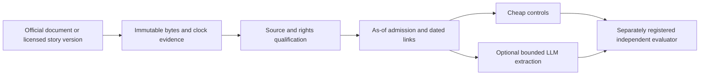

# Portable point-in-time event evidence contract

**Status: `EVENT_SOURCE_QUALIFICATION_NEEDED`.** The design is specified; no event
feed has been qualified for historical actionable research. Missing original
versions/receipt clocks, coverage reconciliation, dated exposure links and
licensing/retention evidence prevent a stronger status. These are source gates,
not a reason to alter the scientific question or invent timestamps.

This is the design deliverable for [Issue #12](https://github.com/emanuel894/trading_agent/issues/12),
based on `feat/alpaca-paper-foundation` at
`b5b06af7a876ebb4c7fc9ab6f63cbaed9ef2aafe`. User-facing review date: October 18,
2026, Asia/Jerusalem. Source captures retain their actual UTC retrieval times.

| Required output | Artifact |
| --- | --- |
| Canonical envelope and field semantics | [JSON Schema](event-evidence.schema.json), [contract](CONTRACT.md), [synthetic examples](examples/) |
| Source responsibilities by family and clock | [source matrix](SOURCE_MATRIX.md) |
| Point-in-time admission | [contract: admission](CONTRACT.md#admission) |
| Corrections, revisions, duplicate/retraction rules | [contract: version history](CONTRACT.md#version-history) |
| Historical entity/exposure links | [contract: entity-links](CONTRACT.md#entity-links) |
| Cheap controls before AI | [baselines](BASELINES_AND_FIRST_EXPERIMENT.md) |
| Licensing/retention and qualification unknowns | [qualification register](QUALIFICATION.md) |
| Smallest separately registered future experiment | [proposal](BASELINES_AND_FIRST_EXPERIMENT.md#first-separately-registered-experiment-proposal) |
| Current authoritative source/maintained-client evidence | [source packet](sources/README.md), [captures](sources/captures.json), [bounded quotations and inferences](sources/claims.json) |
| Verification and resume | [verification](verification.json), [checkpoint](CHECKPOINT.md) |

The contract keeps official release assertions, actual collector observations,
and hypothetical historical latency assumptions separate. One immutable record
represents one source document/story version. A release can contain many
observations and revisions; multiple sources can describe the same economic event.
Common event IDs do not collapse their provenance or clocks.

The schema is a portable **design**, not an installed collector or production
admission engine. The offline verifier checks artifact structure/integrity and
illustrative invariants; it cannot certify source truth, completeness or rights.
No production code, dependencies, workflows, existing registrations, Amendment
005, candidate ledger or broker settings are changed. FMBH remains UNRESOLVED;
candidate #2 is untouched. PR #10 was read for architecture context only. No
alpha experiment, paid data/provider/model request, purchase, subscription or
broker action was performed.

PR #10 context: [architecture audit](https://github.com/emanuel894/trading_agent/blob/4dd7703f429df01a6f7e67912294ec26e93b4ad0/LONG_TERM_BUILD_VS_ADOPT_20261018.md),
especially its future-source section. Its advice is context, not authority to
change the current 10-Q registration. Existing ADR 001 and repository policy
remain scientific authority; this proposal registers no new evaluation.
