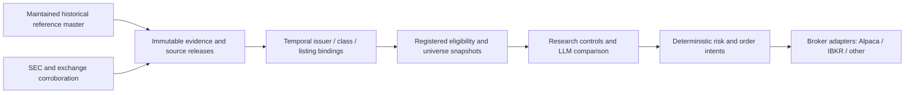

# Security-master scientific and architecture review

**Primary outcome: B) DATABENTO_QUALIFICATION_NEXT.**

Request a free, provider-produced FMBH Reference Security Master sample and a
written temporal/coverage specification. Qualify a **composed evidence method**:
a maintained historical reference master supplies the population and lineage;
SEC/issuer documents bind legal identity; exchange evidence resolves boundaries
that the master cannot establish. Do not purchase, integrate or select Databento
as the permanent supplier yet. FMBH remains **UNRESOLVED**.

This is a review of Issue [#7](https://github.com/emanuel894/trading_agent/issues/7)
and exact commit `090e8bbb80ceec58bb76e75a3e69fd79719b8737`. The issue's current
body version still matches the reviewed snapshot. Amendment 005, the ledger,
candidate order and all scientific registrations are unchanged. Date: October
18, 2026, Asia/Jerusalem; capture metadata records actual UTC separately.

## Decisive reasoning

The existing packet proves neither a complete free solution nor that one is
impossible. It does expose a concrete testable interface: Databento documents
effective-from state, separate record/update clocks and an issuer–security–listing
hierarchy, with issuer-ID queries. This is enough to prioritize **qualification**,
not enough to admit data. Its most important unanswered questions are historical
coverage, complete qualifying-class enumeration and revision behavior, not the
number of digits in its timestamp.

There is no demonstrated scientific necessity to amend 005 before asking those
questions. Nor is there evidence that a large enterprise subscription is the
smallest necessary solution. The next action can cost zero and falsify the lead
quickly. A second round of broad SDK reading or another 58 ticker-date requests
has much less information value than a provider's bounded coverage answer and
actual sample.

Databento is the **best next qualification experiment among the inspected paths**,
not a proved market-wide best security master. CRSP is a serious alternative for
the long historical US research backbone; FactSet's bulk reference products and
LSEG historical reference are serious enterprise alternatives. Their exclusion
from first place is provisional: no existing entitlement, qualified full method,
bounded sample or minimum commercial quote was established for any of them.
An existing authorized CRSP/enterprise license would materially change that cost
comparison. None is assumed to exist.

## 1. What is scientifically necessary, and what is overreach?

The actual estimand is incremental LLM-derived **net** value over strong cheap
controls. Correct identity and ex-ante opportunity selection are necessary to
make that comparison meaningful. A future surviving ticker cannot stand in for
a historical failed company; a liquid Class A cannot silently replace Class B;
nor may missing source data delete inconvenient observations.

| Requirement | Scientific judgment and unchanged treatment |
| --- | --- |
| Historical issuer, common-class and listing identity | Essential. Ticker equality, CIK equality or a permanent vendor ID alone does not prove every relationship. Preserve the hierarchy and temporal crosswalks. |
| Complete set of potentially qualifying classes at the cutoff | Essential for the registered most-liquid-class choice. Complete means **within the eligible population**, including inactive-today classes that were eligible then. |
| The entire worldwide legal capital structure, every private/preferred/debt class and every foreign listing | Not intrinsically required. An authoritative census of potentially qualifying NYSE/Nasdaq common classes plus justified exclusions suffices. Unknown type/issuer relationships must not be filtered out by convenience. Discovery may return broader data; that does not impose exhaustive legal reconstruction of every irrelevant instrument. |
| State at monthly cutoff, acceptance and action | Required under the current design. Those instants prevent selecting a new/replacement class after the cutoff. They are design-specific safeguards, not proof that every alpha study needs intraday legal history. |
| Native second/nanosecond effective timestamps for every structural field | Not intrinsically required. What matters is a source-grounded interval containing the target, or corroboration establishing the same fact there. Timestamp encoding cannot substitute for this proof. |
| A date-only row assigned midnight | Still forbidden. A daily observation is not an all-day validity guarantee. Independently grounded corroboration required by 005 remains mandatory for exact instants. |
| Separate valid, publication/revision, observation and retrieval clocks | Essential. Unknown historical first publication is allowed for 005's narrow retrospective structural purpose; it cannot be invented for predictive or actionability inputs. |
| One vendor proves every field and every boundary | Unnecessary. The **assembled evidence package** must satisfy the contract; its sources may have complementary responsibilities. Conflicts remain unresolved. |
| Mathematical certainty that no source ever omitted anything | Neither attainable nor the scientific standard. Require documented bounded coverage, enumeration semantics, completion/control records, correction handling and independent reconciliation. A reviewer checkbox, hash or sales assurance is not enough. |

A useful test is: **do all histories consistent with the admitted evidence give
the same required structural state at the target instant?** If yes, coarse native
precision need not prevent a determination. If an unresolved date boundary or
intraday change could change that answer, retain UNRESOLVED. For example, a
documented complete change history plus independent exchange-effective semantics
can establish a stable interval; four matching snapshots cannot establish the
absence of intervening changes. This is an interpretation of 005's existing
corroboration route, not permission to manufacture endpoints.

Three further architecture issues matter beyond FMBH:

1. **005 is acquisition/provenance feasibility only.** A successful retrospective
   reconstruction cannot automatically feed the stricter performance selector or
   establish live knowledge. Any later performance-use rule must be explicitly
   registered and reviewed. Retrospective corrections can affect classifications
   and universe membership even when every model arm uses the same universe.
2. **Broker independence is not measurement interchangeability.** Amendments
   003/004 deliberately freeze an Alpaca SIP provider-native daily liquidity
   measure. Keep that implementation and its provenance for this registration.
   A future vendor-neutral measurement definition needs a separate amendment and
   equivalence evaluation; swapping in another vendor's close/volume behind the
   same interface would silently change class selection and the experiment.
3. **Strict rank-one blocking is a registered sampling choice.** It prevents
   availability-based substitution here. It is not a universal prerequisite to
   measuring LLM value, nor a reason to fund indefinite security-master engineering.
   No candidate substitution or new audit design is proposed in this task.

A future daily-state design with explicit effective-date rules and exception
handling could be defensible if motivated before outcomes, with its affected
population, uncertainty and biases evaluated. That possibility does not justify
changing 005 now. FMBH's actual evidence is still insufficient under the current
contract, including this narrower interpretation.

## 2. Assessment of the prior Sol research

**Right:** separated historical validity from knowledge; preserved the four
Massive date-level observations without using `last_updated_utc` as effective
time; stopped the remaining 58 calls; kept FMBH unresolved rather than ineligible;
distinguished Reference Security Master from ITCH definitions; found Databento's
allocation omission and LEAN's latest-exchange hazard; did not infer incapacity
from blocked websites or mistake SDK tests for FMBH data. Its 87 source-file
hashes and 18 byte-grounded excerpts were independently checked again here.

**Needs correction or a narrower reading:**

- `findings.json` asks for a “full issuer census and authoritative legal-class
  reconciliation”; `NEXT_ACTION.md` asks to reconcile every returned class.
  Those phrases can exceed 004's **qualifying-class** requirement. The revised
  request below keeps broad discovery while bounding the facts that need proof.
- The paid-product test in the report's decision section requires a named product
  to supply **both** the class set and full effective history. A product can be
  worth buying for one missing component of a qualified multi-source method.
- Native temporal precision was correctly flagged as unknown, but should not
  become a preference for a nanosecond schema over a documented daily interval
  with independent effective-boundary corroboration.
- Databento's stronger schema was not a sufficient comparison of **historical
  research coverage**. The future training period starts in 2018 and requires
  pre-2018 lookback inputs. A product that solves May 2025 but starts later than
  the research window cannot be the sole long-term backbone.
- The Nasdaq transport repository is genuine upstream code but weak evidence
  about Nasdaq's **reference products**. A protocol library's lack of historical
  records says little about Daily List or a licensed issue-reference archive.
- `GENUINE_SOURCE_BLOCKER` was defensible under the prior three-way output rule
  when carefully bounded to “no complete method qualified.” It should not become
  the architecture decision. Under this review's richer choices, an explicit
  qualification next step is better supported than a terminal blocker claim.

No prior claim of actual eligibility is overturned, and no inspected source is
newly declared complete. The original packet remains intact for auditability.

## 3. Databento: evidence, limits and disqualifying answers

Inspected current official [Rust security schema][db-schema], [Python method][db-python],
[changelog][db-changes], [corporate-action schema][db-actions] and public fixtures.
Git HEADs were rechecked. PyPI reports Python client 0.87.0, released September
22, 2026, requiring Python >=3.10; repository tests here do not test that SDK.

| Question | Current authoritative evidence | Qualification still required |
| --- | --- | --- |
| Valid time | `ts_effective`: “timestamp (UTC) the record details are effective from.” | Which fields share that clock? Actual effective event vs provider processing/normalization; native date/time precision and timezone rules; when a midnight value is synthetic. |
| Other clocks | `ts_record` is record-last-changed; `ts_created` is added by Databento. | Original-source publication, corrected/backdated values, ordering, deletion/tombstone and supersession rules. These clocks do not by themselves implement a two-time as-known query. |
| Hierarchy | `issuer_id`, `security_id`, `listing_group_id`, `listing_id`; CIK, CFI, ISIN/FIGI, description and exchange fields. | Historical issuer membership, reorganization/reuse policy and class-vs-listing identity; issuer groups must include classes not surviving today. Same CIK does not prove every association. |
| Query scope | 0.84.0 adds issuer/security/listing ID inputs. Range uses inclusive start/exclusive end on a selected clock. | Complete historical issuer discovery, carry-in baseline preceding start, pagination/omission behavior, and historical issuer-ID changes. An unchanged record effective before start can be missed. |
| Listing status | Listing and delisting **date** fields and market-level status; primary exchange separate from exchange/MIC. | Authoritative boundaries, primary-listing codebook, distinction between delisting, trading suspension and listing availability. No halt/tradability inference. |
| Completeness | Schema has linked IDs; no inspected production completeness specification or FMBH sample. | Coverage universe/history start by field, active and delisted counts, exclusions, late additions, complete baseline/deltas, explicit known gaps. Linkable IDs do not prove a closed class set. |
| Corrections/corporate actions | Separate action endpoint has event IDs, action status, record clock and multiple date fields. | What is complete, which lifecycle events change identity, and how to reproduce a chosen evidence release. Corporate-action dates alone do not prove legal succession or total-return treatment. |
| Allocation | `allocate_isins=False` drops rows requiring new allocations; default true may allocate under ISIN-limited plans. | Provider-prepared complete no-charge sample, no account allocation or surprise charge, exact minimum commercial terms. |
| History | Public fixtures contain Apple and a Rust mock with older dates. | **No product-history start or FMBH production coverage verified.** Old dates in a mock do not prove old coverage. Ask separately about May 2025 and 2017 warm-up/2018 onward. |
| Pricing/access | API-key client and ISIN-limited-plan behavior documented. | Current Reference-specific free sample/trial eligibility, minimum price, bulk/archive/update/identifier rights, retention after termination. Market-data trial credits or `metadata.get_cost` must not be assumed applicable to Reference. |

A row-level effective timestamp can conceal different field vintages. Ask whether
changing an industry classification rewrites an entire record whose other fields
have distinct histories. Neither sorting on `ts_effective` nor taking the last
row silently resolves duplicate effective times, backdated corrections or erased
records. Preserve source rules rather than invent a generic last-write-wins rule.

**Reject Databento as the sole backbone** if its history cannot reach the required
warm-up, historical issuer queries omit delisted/detached classes, baseline plus
relevant transitions cannot be reconstructed, or export/replay rights force
scientific truth into a proprietary runtime. A partial product may still be useful
as corroboration, but must not pull the entire system into a custom patchwork.
No such failure is asserted yet; these are bounded qualification tests.

## 4. Broad alternatives and build-versus-buy

| Source/product family | Evidence inspected and practical role | Decision for this question |
| --- | --- | --- |
| SEC/issuer + Nasdaq/NYSE reference and effective-change records | Existing FMBH SEC covers are identity anchors. New SEC charter/exchange product fetches remain blocked. A dated directory plus a demonstrably complete change ledger could close the interval; public snapshots and transport code alone cannot. | Integrate as authoritative corroboration/exception evidence. Free full method unproved. Do not build an exchange-history reconstruction service. |
| Databento Reference Security Master | Explicit effective clock and hierarchy, maintained Python/Rust interfaces; unresolved actual coverage, complete history and commercial terms. | **First free qualification**, conditional backbone. |
| CRSP US Stock via WRDS or direct licensed access | Maintained official [WRDS README][wrds] exposes PERMNO/PERMCO and `stocknames` `namedt`/`nameenddt` DATE fields. Product manuals and precise current coverage/rights remain inaccessible here. | Strong research-backbone alternative, especially with existing authorized institutional access. Qualify CIK/legal-class links, dead securities, exchange history, delisting outcomes and exact-boundary corroboration. Do not reject merely because dates are daily, or treat PERMCO as a proven CIK equivalence. |
| FactSet Symbology/Entity + Standard DataFeed reference products | Historical identifier API and entity-listing API inspected. Newly inspected [SDF][factset-sdf] provides full/delta files and historical packages; data dictionary exposes product/table/field discovery. The README's “since 1995” is a general service statement, **not proof every reference field has that history**. | Credible enterprise fallback. Ask for the specific historical issuer/security/listing schema and sample, not just Entity's current securities endpoint. Current endpoint limitations do not disprove bulk-product capability. |
| LSEG DataScope Select / Tick History historical reference | Official [Postman example][lseg-history] explicitly uses `HistoricalBulkSearch`, `HistoricalReferenceExtractionRequest`, `ReferenceHistory`, historical/inactive validation and a Change Date. It separately labels current EquitySearch. Current maintained Python examples show symbol conversion and issuer identifiers. | Stronger alternative than the prior uninspected label. Historical identifier/exchange capability is real; issuer-class population, effective-field boundaries and price still unqualified. Do not use current primary-RIC selection as historical class enumeration. |
| Morningstar directly / through QuantConnect | QC's official docs describe historical universes, daily sparse fundamentals, mostly monthly key updates, forward-filled copies; older filing dates can be approximated by 45 days. | Useful reference corroboration; direct Morningstar licensing/semantics need separate qualification. Approximated filing availability is not admissible event-time disclosure evidence. |
| QuantConnect US Equity Security Master / LEAN | Historical map/factor/corporate-action files, daily New York dates since 1998; current price table begins $600/year. Download terms say internal LEAN use, no redistribution/conversion. | Useful benchmark or licensed engine input, **poor default for a vendor/engine-neutral truth layer** unless separate written rights allow it. No engine migration just to get this data. |
| Norgate Data | New primary [package documentation][norgate] describes unchanging asset IDs, a delisted database, historical major-exchange/blank-check indicators and current symbol translation. Major-exchange flag includes NYSE American/Arca/Cboe/IEX, not only XNYS/XNAS. NDU requires Windows and an active subscription; historical indicators require Platinum/Diamond. | Credible low-complexity daily-research alternative, not dismissed as survivor-only. Exact historical primary exchange, issuer/class completeness and cloud/export rights need qualification. The broad flag alone cannot implement our exchange filter. No Windows infrastructure build now. |
| Massive historical All Tickers | Prior four dated responses remain admissible at that resolution; maintained SDK documents date-relative active and CIK filters. | Reuse existing evidence; seek free semantic clarification if needed. No 58-call completion exercise. Current tickers plus a historical price series are not a master. |
| OpenFIGI | Maintained official mapping examples; stable identifiers useful for reconciliation. | Integrate identifiers only when historically bound; no demonstrated full historical population/update contract. Free mapping is not a substitute master. |
| Nasdaq Data Link / Sharadar; EODHD | Data Link client is delivery plumbing, not the content specification. Current [EODHD library][eodhd] documents ID mapping and implements date-filtered symbol-change history. | Possible daily research inputs; not qualified historical qualifying-class censuses. No low-price subscription simply because it exposes a ticker-history endpoint. |
| ICE, SIX, Exchange Data International, S&P/Compustat and direct exchange reference products | Credible enterprise product families to compare if the first qualification fails. Primary specification/price pages attempted where available but blocked; no actual historical sample obtained. | Deferred qualification, **not scientifically rejected**. Do not infer exact historical guarantees from brand or product name, or buy overlapping enterprise feeds. |

Product websites, SEC and exchange origins returned proxy tunnel 403 here;
GitHub and package-registry material was accessible. That limits ranking
confidence and prevents a current verified Reference price or exhaustive free
path claim. See the [capture inventory](research/structural_source_007_red/review_sources.json)
and [exact excerpts](research/structural_source_007_red/review_excerpts.json).
No bypass, source account, paid endpoint or provider message was used.

## 5. Long-term architecture: buy the master, retain our research contract

Use **one qualified maintained historical backbone**, supplemented by narrow
authoritative evidence. Do not operate several equal “truth” feeds and vote on
them. Source responsibility is field- and period-specific; disagreements enter an
exception queue and remain unresolved until adjudicated with evidence.

Keep our raw object hashes, source/rights references, append-only decisions,
registrations and deterministic unresolved gates. Integrate maintained provider
SDKs or bulk loaders rather than rebuilding transport. Use ordinary tables and
versioned object storage; the current local store is sufficient for qualification.
No new master service, graph platform or orchestration framework is needed.

The small project-specific binding layer should retain:

- Source IDs at issuer, economic/legal share-class and listing/venue levels,
  plus internal opaque IDs and dated, evidence-backed crosswalks. Preserve
  predecessor/successor relations; ticker reuse never merges economic entities.
- Field-level validity or the provider's documented record-level validity;
  native precision/timezone, publication/revision/receipt/retrieval clocks,
  source release and parser version. Unknown clocks remain null. A retrospective
  view and an as-observed view must never share an invented `known_at`.
- Population manifests and full/delta completion markers, including delisted and
  inactive-today securities, known exclusions and missing/conflicting cases.
  Select the issuer/class after historical enumeration, never from broker assets.
- Corporate actions as versioned events with separate announcement/effective/ex/
  payment dates and source-backed successor links. Split adjustment, total-return
  calculation, merger consideration and delisting recovery are different facts.
  No default zero or last-price liquidation for missing terminal outcomes.
- Exact source-release/input/registration hashes for each universe snapshot and
  experiment. Preserve the old result when corrected data produce a new version.

A broker's symbol/contract ID is an **execution mapping** valid for a broker and
time. It is not a historical issuer ID, eligibility authority, or proof of
tradability across the research universe. Keep live status and permission checks
downstream. Alpaca and future IBKR connectivity must consume scientific bindings,
not redefine them. A backtest engine similarly consumes frozen research inputs.

This architecture scales if the purchased backbone supplies bulk histories,
complete relevant populations, delisted coverage and correction streams across
the required years. Hand-reviewing every issuer's charter on every date does not.
Use automated consistency checks and targeted adjudication for exceptions; the
vendor retains responsibility for maintaining the reference universe. Passing
one stable FMBH sample would be necessary evidence for this candidate, not proof
of universe-wide completeness or complicated corporate-action handling.

Before a future full-universe purchase, require provider documentation and existing
sample cases for delisting, ticker reuse, dual common classes, exchange transfer,
reorganization and retroactive correction, plus coverage back through the 2017
warm-up. That is supplier acceptance design, **not authorization to screen
candidate #2 or expand the current scientific sample**.

## 6. Minimum next action, cost and stop rules

The exact unsent [qualification request](research/structural_source_007_red/PROVIDER_REQUEST.md)
is ready. Ask Databento first for yes/no history/coverage/rights answers and a free
static FMBH export. A signed-in trial, credit card or generic “PIT” brochure is
not the acceptance evidence. Provider qualification can proceed while free
SEC/exchange documents are inspected; those independent steps need not be
serialized behind the network problem.

**Cost now: $0 external spend.** No paid model API, Reference allocation,
subscription or full-universe purchase. Free provider documentation plus a static
sample is the requested minimum; availability of that free sample is unconfirmed.
If it is refused, record the refusal and seek a qualified alternative before
paying simply to discover the semantics.

For a later bounded acquisition after free semantic/sample qualification, I
recommend an owner-approved **one-off ceiling of $250 total incremental data
spend before alpha evidence**, with no annual commitment or automatic renewal.
This is a proposed project stop-loss, not a vendor quote, authorization or claim
that $250 buys all data required by the full experiment. If a defensible minimum
exceeds it, bring back the exact quote and scientific benefit for an explicit
investment decision rather than silently funding infrastructure.

Costs that can falsify acquisition feasibility may rationally precede alpha;
requiring proven alpha before buying any necessary research data would be circular.
But a speculative enterprise subscription is unjustified. At the registered
virtual $10,000 portfolio, even $600/year is a 6% annual fixed-cost burden before
quotes, computation or fees. That illustration is not a capital/budget assumption
about the owner. Preserve both common and incremental costs under the registered
paired comparison and full portfolio survival gate.

Accept the path only when the **combined** sample and documentation establish all
potentially qualifying classes, correctly bound 60-session history and validity
at all three instants, without an ungrounded transition assumption. It may still
lead to a source-backed ineligible result later; qualification is not eligibility.
If Databento lacks history or required population semantics, carry the same bounded
request to CRSP/WRDS where existing access is available, otherwise FactSet reference
bulk products or LSEG historical reference. Do not endlessly patch a failed master.

Explicitly do **not** build or buy now: a custom global security master; general
ITCH replay to infer legal classes; a broker-derived historical universe; an LLM
that fills missing identity facts; a LEAN migration to obtain data; duplicate
enterprise subscriptions; full tick/order-book history; annual reference plans;
or more date coverage that cannot resolve the structural issue. No alpha
experiments, candidate advancement, registration edits or trading occur here.

[db-schema]: https://github.com/databento/databento-rs/blob/72316bd104b47a2a9c24d10eb10f6daad9b36735/src/reference/security.rs
[db-python]: https://github.com/databento/databento-python/blob/25eef4ee8e66559e2370166a57c20925ce244d49/databento/reference/api/security.py
[db-changes]: https://github.com/databento/databento-python/blob/25eef4ee8e66559e2370166a57c20925ce244d49/CHANGELOG.md
[db-actions]: https://github.com/databento/databento-rs/blob/72316bd104b47a2a9c24d10eb10f6daad9b36735/src/reference/corporate.rs
[wrds]: https://github.com/wharton/wrds/blob/5d7bf38de5bd367852b7ccdd05079c1a1820f888/README.md
[factset-sdf]: https://github.com/factset/enterprise-sdk/blob/814439cdd02f3c2d90735e56dd90568ce9385631/code/python/StandardDatafeed/v2/README.md
[lseg-history]: https://github.com/LSEG-API-Samples/Article.TickHistory.Postman.ISINToRIC/blob/5a0db3ad89edac61a2b539423986cc2e5dbd08e0/Tick%20History%20REST%20ISIN%20TO%20RICS.postman_collection_v2.json
[norgate]: https://pypi.org/project/norgatedata/1.0.77/
[eodhd]: https://github.com/EodHistoricalData/EODHD-APIs-Python-Financial-Library/blob/440e028dea70fd726bf9da3dddb6031bf42e88f6/README.md
